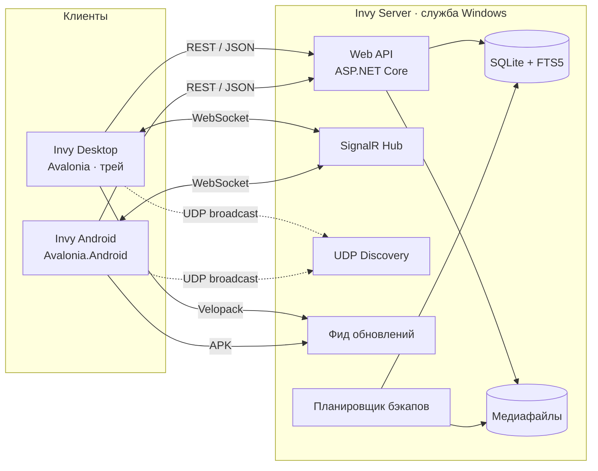
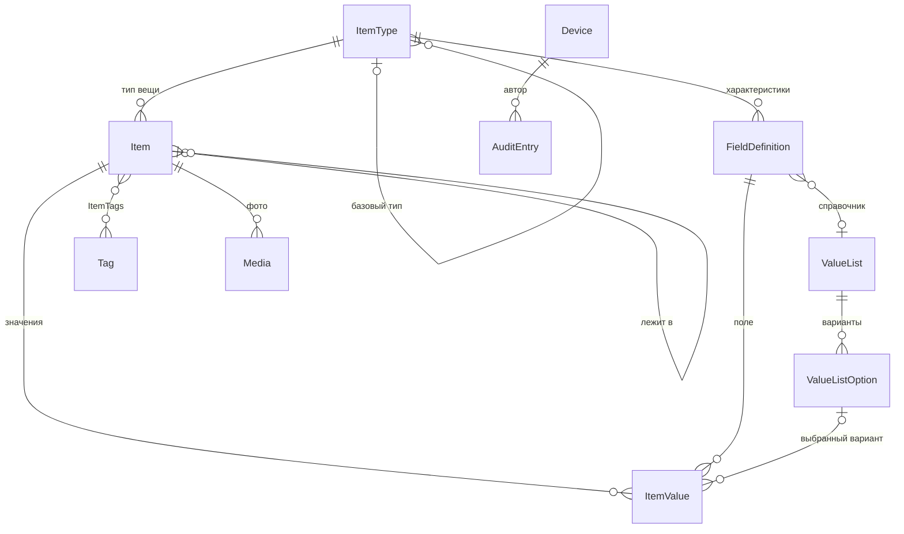
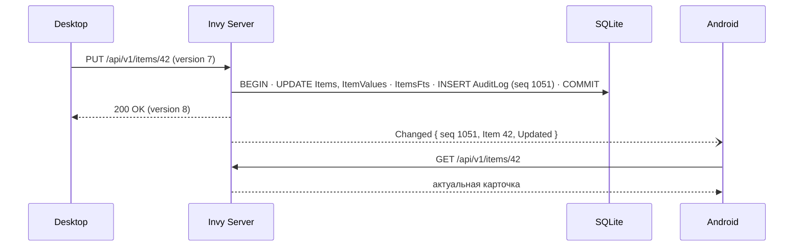
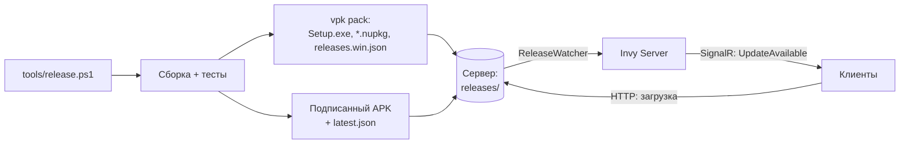
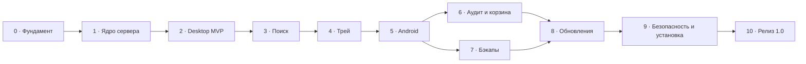

# Invy — план разработки

> Целевая архитектура, модель данных, UX и поэтапный план реализации Invy — гибкого приложения для домашней инвентаризации.
> Описание для пользователя — в [README.md](README.md).

**Статус:** фаза 0 выполнена, кроме ручной проверки на Windows и Android · **Версия плана:** 1.1 · **Дата:** 2026-11-04

## Содержание

1. [Цели и принципы](#1-цели-и-принципы)
2. [Глоссарий](#2-глоссарий)
3. [Объём работ](#3-объём-работ)
4. [Архитектура](#4-архитектура)
5. [Модель данных](#5-модель-данных)
6. [Сервер](#6-сервер)
7. [Клиенты](#7-клиенты)
8. [Автообновление](#8-автообновление)
9. [Автозапуск](#9-автозапуск)
10. [Тестирование и качество](#10-тестирование-и-качество)
11. [Нефункциональные требования](#11-нефункциональные-требования)
12. [Дорожная карта](#12-дорожная-карта)
13. [Риски](#13-риски)
14. [Бэклог после 1.0](#14-бэклог-после-10)
15. [Открытые вопросы](#15-открытые-вопросы)

---

## 1. Цели и принципы

**Цель:** за секунды отвечать на вопрос «где лежит X?» и так же быстро заносить вещи в систему.

| # | Принцип | Что это значит на практике |
|---|---------|----------------------------|
| 1 | **«Проводник для вещей»** | Места и коробки — как папки, вещи — как файлы. Знакомые действия: открыть, перетащить, вырезать/вставить, `F2`, `Del`, хлебные крошки. |
| 2 | **Ввод быстрее, чем на бумаге** | Обязательно только название (а с шаблоном типа — даже оно генерируется). Умные значения по умолчанию, автодополнение, «Сохранить и добавить ещё». |
| 3 | **Гибкость без перегрузки** | Прогрессивное раскрытие: обычная форма — простая; конструктор типов, справочники и язык запросов — для тех, кому нужно. |
| 4 | **Везде одновременно** | Изменение на одном устройстве видно на остальных за ~1 с (SignalR). |
| 5 | **Данные не теряются** | Корзина, аудит каждого изменения, бэкапы по расписанию с проверкой, бэкап перед каждой миграцией. |
| 6 | **Локально, без облака** | Всё работает в домашней сети; интернет не нужен. |
| 7 | **Ноль обслуживания** | Автозапуск, автообнаружение сервера, самообновление, понятные статусы. |

## 2. Глоссарий

| Термин в UI | В коде | Описание |
|-------------|--------|----------|
| Вещь | `Item` | Любой учитываемый объект: кабель, пакет, коробка, полка, чердак. Все вещи образуют одно дерево. |
| Тип | `ItemType` | Пользовательский шаблон вещи («Кабель», «Коробка», «Место»). В постановке задачи — «сущность». Задаёт характеристики, иконку и роль. |
| Роль типа | `TypeRole` | `Item` — обычная вещь; `Container` — может содержать вещи (коробка, пакет, сумка); `Place` — место (дом, чердак, сарай, кладовка). |
| Характеристика | `FieldDefinition` | Поле типа: имя, тип данных, единица измерения, обязательность, справочник, группа. |
| Справочник | `ValueList` | Список значений для полей-списков («Версия USB»: 2.0 / 3.0 / 3.1). Может быть общим для нескольких полей и типов. |
| Значение | `ItemValue` | Значение характеристики у конкретной вещи. |
| Тег | `Tag` | Цветная метка для любых вещей (`#зарядка`, `#на-продажу`). |
| Медиа | `Media` | Фото вещи (позже — документы, чеки). Файлы хранятся на диске сервера. |
| Неразобранное | — | Вещи без места — «входящие», куда попадает всё, добавленное без указания места. |
| Устройство | `Device` | Сопряжённый клиент (ПК, телефон). От его имени пишется история изменений. |
| Запись аудита | `AuditEntry` | Кто, когда, что было → что стало. Её `Id` — номер изменения (`seq`) для синхронизации. |

## 3. Объём работ

**Must — версия 1.0**

- Дерево вещей с неограниченной вложенностью; перемещение (drag & drop, вырезать/вставить, «Переместить в…»), защита от циклов.
- Пользовательские типы и характеристики (10 типов данных), справочники, порядок и группы полей.
- Фото (несколько на вещь, обложка), иконки (Fluent / эмодзи / свои), цвет.
- Теги; полнотекстовый поиск + фильтры + язык запросов; сохранённые поиски.
- Обновление в реальном времени на всех клиентах (SignalR) с догоняющей синхронизацией.
- Аудит и история записи; корзина с восстановлением.
- Бэкапы по расписанию: ротация, проверка целостности, восстановление из UI.
- Desktop: трей, глобальные горячие клавиши, быстрый поиск/добавление, автозапуск, тёмная/светлая тема.
- Android: просмотр, поиск, добавление с камеры, перемещение.
- Автообнаружение сервера в LAN, сопряжение устройств.
- Автообновление Desktop и Android из локальной сети.
- Сервер — служба Windows с автозапуском.

**Should — желательно в 1.0:** авто-название по шаблону типа, наследование типов, табличный режим с inline-редактированием, конвертация типа данных поля, откат изменения из истории, стартовый набор типов, количество и минимальный остаток, HTTPS с пиннингом сертификата, импорт/экспорт CSV/JSON.

**Could — после 1.0:** см. [бэклог](#14-бэклог-после-10).

**Won't:** облачный сервис, мультиарендность, публикация сервера в интернет без VPN.

## 4. Архитектура

### 4.1 Обзор

Один сервер в домашней сети — единственный источник истины. Клиенты работают с ним по REST, получают уведомления через SignalR и находят его UDP-широковещанием. Сервер же раздаёт обновления клиентов.



Рекомендуемое развёртывание: сервер — на всегда включённом ПК или мини-ПК; Desktop — на любых ПК в сети (в т. ч. на том же).

### 4.2 Ключевые решения

| # | Вопрос | Решение | Почему | Альтернативы |
|---|--------|---------|--------|--------------|
| 1 | UI Desktop + Android | **Avalonia UI 12.1** + **FluentAvalonia 3.1** (подтверждено спайком, ADR 0002) | Один XAML-код для Windows и Android; тема в стиле Windows 11 (Mica, NavigationView, ContentDialog, InfoBar, SettingsExpander); встроенный `TrayIcon`; Dark/Light; готовая интеграция с Velopack | .NET MAUI — слабее стиль Win11, нет трея; WinUI 3 + MAUI — лучший нативный вид, но два UI-кода; Uno Platform — сложнее сборка |
| 2 | Доступ к данным | **EF Core** — схема, миграции, запись, аудит. **Dapper** — сложное чтение: поиск, дерево, счётчики, лента изменений | EF удобен для модели и транзакций, Dapper — для динамического SQL с FTS5 и рекурсивными CTE | Только EF — неудобен динамический SQL; только Dapper — ручные миграции |
| 3 | Хранилище | **SQLite** (WAL) + медиафайлы на диске | Ноль администрирования, один файл, простой бэкап | PostgreSQL — избыточно для дома |
| 4 | Пользовательские поля | **Типизированный EAV**: `ItemValues` с колонками Text / Number / Date / Bool / Option / Ref | Индексы и сравнения по типу (`длина>100`), сортировка, ссылочная целостность справочников | JSON-колонка — проще запись, хуже фильтры, сортировка и целостность |
| 5 | Дерево | **Список смежности** (`ParentId`) + рекурсивные CTE | Перемещение = изменение одного поля; на масштабе дома (≤ 100 тыс. вещей) CTE работают за миллисекунды | Materialized path / closure table — если упрёмся в производительность |
| 6 | Поиск | **SQLite FTS5** (`unicode61`, префиксные индексы) + структурные фильтры | Встроен в SQLite, ранжирование bm25, подсветка совпадений | Lucene.NET — тяжелее и отдельный индекс |
| 7 | Идентификаторы | **`Guid` v7** (`Guid.CreateVersion7()`) + человекочитаемый `Number` (№ 123) | Клиент может создавать записи офлайн без конфликтов; v7 упорядочен по времени | `int` — проще, но закрывает путь к офлайну |
| 8 | Реальное время | **SignalR-инвалидации** («что изменилось») + `seq` для догоняющей синхронизации | Клиент сам перечитывает нужное; после разрыва связи догружает пропущенное | Рассылка полных объектов — больше трафика и гонок |
| 9 | Обновления Desktop | **Velopack**, фид раздаёт сервер Invy | Дельта-обновления, установка без UAC, одна кнопка «Перезапустить» | MSIX (сложно вне Store), ClickOnce, Squirrel (не развивается) |
| 10 | Обновления Android | **Сервер раздаёт APK + манифест**, приложение ставит через `PackageInstaller` | Без Google Play; одно нажатие + системное подтверждение | Google Play / F-Droid — избыточно |
| 11 | Хостинг сервера | **Служба Windows** (`AddWindowsService`), отложенный автозапуск | Работает без входа пользователя, перезапуск при сбое | Планировщик заданий, автозапуск в сессии пользователя |
| 12 | Поиск сервера | **UDP broadcast** + ручной ввод адреса (+ QR) | Работает на Windows и Android без зависимостей | mDNS (`_invy._tcp`) — опционально |

Каждое решение оформляется отдельным ADR в `docs/adr/` после спайков фазы 0.

### 4.3 Структура решения

```text
Invy/
├── Invy.slnx
├── Invy.NoAndroid.slnf            # всё, кроме Android, — для машин без Android SDK
├── global.json                    # фиксирует .NET SDK 10.0.x
├── dotnet-tools.json              # локальные инструменты: vpk (Velopack)
├── Directory.Build.props          # общие настройки: nullable, анализаторы, версия, TreatWarningsAsErrors
├── Directory.Packages.props       # центральное управление версиями NuGet-пакетов
├── .editorconfig
├── src/
│   ├── Invy.Contracts/            # DTO, перечисления, интерфейсы SignalR, JsonSerializerContext (общее для сервера и клиентов)
│   ├── Invy.Domain/               # сущности и доменные правила: дерево, валидация значений, шаблоны названий
│   ├── Invy.Application/          # сценарии (use cases) и порты: БД, чтение, медиа, уведомления, часы
│   ├── Invy.Infrastructure/       # EF Core + SQLite, миграции, Dapper-запросы, FTS5, медиа, бэкапы, аудит
│   ├── Invy.Api/                  # ASP.NET Core: REST, SignalR Hub, служба Windows, discovery, фид обновлений
│   ├── Invy.Client.Core/          # Refit-клиент, SignalR-клиент, кэши, ViewModels — без зависимости от UI
│   ├── Invy.Client.UI/            # Avalonia: Views, стили, ресурсы, иконки — общее для Desktop и Android
│   ├── Invy.Desktop/              # хост Windows: трей, горячие клавиши, автозапуск, Velopack, single instance
│   └── Invy.Android/              # хост Android: камера, установка APK, обнаружение сервера
├── tests/
│   ├── Invy.Domain.Tests/
│   ├── Invy.Application.Tests/
│   ├── Invy.Infrastructure.Tests/ # настоящий SQLite: миграции, CTE, FTS5, кириллица
│   ├── Invy.Api.Tests/            # WebApplicationFactory + SignalR
│   └── Invy.Client.Tests/         # ViewModels, Avalonia.Headless
├── tools/                         # pack-desktop.ps1, pack-android.ps1; позже release.ps1, install-server.ps1
├── docs/                          # ADR, результаты спайков, скриншоты, чек-листы
└── .github/workflows/ci.yml
```

**Зависимости проектов** (стрелка — «зависит от»):

```text
Invy.Api ──► Invy.Infrastructure ──► Invy.Application ──► Invy.Domain
   └──────────────────────────────────────────────────► Invy.Contracts ◄── Invy.Client.Core ◄── Invy.Client.UI ◄── Invy.Desktop / Invy.Android
```

**Целевые платформы:** сервер и общие библиотеки — `net10.0`; Desktop — `net10.0-windows10.0.19041.0` (Win32 API, DPAPI, toast); Android — `net10.0-android` (minSdk 26 / Android 8.0).

### 4.4 Технологии

| Область | Выбор |
|---------|-------|
| Платформа | .NET 10 (LTS), C# 14 |
| Сервер | ASP.NET Core 10 Minimal API, встроенная валидация, ProblemDetails, `Microsoft.AspNetCore.OpenApi` + Scalar |
| Реальное время | ASP.NET Core SignalR / `Microsoft.AspNetCore.SignalR.Client` |
| БД | SQLite: `Microsoft.EntityFrameworkCore.Sqlite` 10, `Microsoft.Data.Sqlite`, FTS5 |
| SQL | EF Core 10 (запись, миграции), Dapper (чтение) |
| UI | Avalonia UI, FluentAvalonia, FluentIcons.Avalonia (Fluent UI System Icons, MIT) |
| MVVM | CommunityToolkit.Mvvm (source generators, `WeakReferenceMessenger`) |
| HTTP-клиент | Refit + `Microsoft.Extensions.Http.Resilience` |
| JSON | System.Text.Json + source generation (trim-safe для Android) |
| Изображения | SkiaSharp (превью, поворот по EXIF, удаление метаданных) |
| Обновления | Velopack (Desktop), собственный апдейтер APK (Android) |
| Планировщик | Cronos (cron-выражения) + `BackgroundService` |
| Логи | Serilog (файлы, журнал событий Windows) |
| Win32 | Microsoft.Windows.CsWin32 (`RegisterHotKey` и др.) |
| QR-коды | QRCoder |
| Тесты | xUnit v3, Shouldly, NSubstitute, Avalonia.Headless, BenchmarkDotNet |
| CI | GitHub Actions (`windows-latest`, workload `android`) |

Перед подключением любого пакета проверяется лицензия (предпочтение — MIT/Apache-2.0).

## 5. Модель данных

### 5.1 Схема



### 5.2 Таблицы

Общие колонки агрегатов: `Version INT` (оптимистичная блокировка), `CreatedAt`, `UpdatedAt` (UTC, Unix ms), `CreatedBy`, `UpdatedBy` (→ `Devices`).

```text
ItemTypes — типы вещей
  Id             TEXT PK      Guid v7
  Name           TEXT         уникально без учёта регистра («Кабель»)
  BaseTypeId     TEXT NULL    → ItemTypes; наследование характеристик (Should)
  Role           INT          0 = Item, 1 = Container, 2 = Place
  IconKind       INT          Fluent | Emoji | Custom
  IconValue      TEXT         имя символа Fluent / эмодзи / MediaId
  Color          TEXT NULL    #RRGGBB — цвет иконки и акцента
  TitleTemplate  TEXT NULL    «{Разъём 1} → {Разъём 2}, {Длина} см» (Should)
  DefaultUnit    TEXT NULL    единица количества по умолчанию («шт», «м»)
  SortOrder      INT
  IsArchived     BOOL         тип скрыт из выбора, вещи сохраняются

FieldDefinitions — характеристики типа
  Id             TEXT PK
  TypeId         TEXT         → ItemTypes (каскад)
  Name           TEXT         «Длина»; уникально в пределах типа
  DataType       INT          см. 5.3
  Unit           TEXT NULL    «см», «Вт», «мАч»
  ValueListId    TEXT NULL    → ValueLists (для списков)
  GroupName      TEXT NULL    секция формы («Габариты», «Покупка»)
  IsRequired     BOOL
  ShowInList     BOOL         показывать чипом в списках и результатах поиска
  RememberLast   BOOL         подставлять последнее введённое значение
  Settings       TEXT JSON    min, max, decimals, maxLength, placeholder, regex, default
  SortOrder      INT
  IsArchived     BOOL         мягкое удаление: поле скрыто, значения сохранены

ValueLists / ValueListOptions — справочники
  ValueLists:       Id, Name («Разъёмы»), IsShared, AllowAddFromForm, SortMode (ручной | по алфавиту)
  ValueListOptions: Id, ListId, Value («Type-C»), Color NULL, SortOrder, IsArchived

Items — вещи, контейнеры и места
  Id             TEXT PK
  Number         INT UNIQUE   инвентарный № (этикетки, поиск «№123»); rowid в FTS
  TypeId         TEXT         → ItemTypes
  ParentId       TEXT NULL    → Items; NULL = корень (места) или «Неразобранное»
  Name           TEXT
  NameNorm       TEXT         lower + «ё»→«е»; сортировка и префиксный поиск
  IsNameAuto     BOOL         название генерируется по шаблону типа
  Description    TEXT NULL
  Quantity       REAL         по умолчанию 1
  Unit           TEXT NULL    «шт», «м», «уп.»
  MinQuantity    REAL NULL    порог «заканчивается» (Should)
  IconKind/IconValue/Color    NULL = как у типа
  CoverMediaId   TEXT NULL    → Media
  IsDeleted      BOOL         корзина
  DeletedAt      INT NULL
  DeletedParentId TEXT NULL   откуда удалена — для восстановления
  индексы: (ParentId, IsDeleted, NameNorm), (TypeId), (UpdatedAt)

ItemValues — значения характеристик (типизированный EAV)
  Id             INTEGER PK
  ItemId         TEXT         → Items (каскад)
  FieldId        TEXT         → FieldDefinitions
  Ordinal        INT          0; для множественного выбора — 0..N
  TextValue      TEXT NULL
  NumberValue    REAL NULL
  DateValue      INT NULL
  BoolValue      INT NULL
  OptionId       TEXT NULL    → ValueListOptions
  RefItemId      TEXT NULL    → Items
  UNIQUE (ItemId, FieldId, Ordinal)
  индексы: (FieldId, NumberValue), (FieldId, OptionId), (FieldId, TextValue), (RefItemId)

Tags / ItemTags
  Tags:     Id, Name (уникально без учёта регистра), NameNorm, Color, SortOrder
  ItemTags: ItemId, TagId — PK (ItemId, TagId), индекс (TagId)

Media — фото и вложения
  Id, ItemId NULL (NULL — пользовательская иконка), Kind (Photo | Icon | Document),
  Sha256 (ключ хранения, дедупликация), ContentType, FileName, SizeBytes,
  Width, Height, Caption NULL, SortOrder, CreatedAt, CreatedBy

Devices — сопряжённые устройства
  Id, Name («Pixel 7»), Platform, Role (Admin | Editor | Viewer), TokenHash (SHA-256),
  AppVersion, LastSeenAt, CreatedAt, RevokedAt NULL

AuditLog — история изменений и лента синхронизации
  Id             INTEGER PK AUTOINCREMENT   = seq
  Timestamp      INT
  DeviceId       TEXT NULL
  EntityType     TEXT         Item | ItemType | ValueList | Tag | SavedSearch | System
  EntityId       TEXT
  Action         TEXT         Created | Updated | Moved | Deleted | Restored | Purged
  Summary        TEXT         «Перемещено: Пакет → Серая коробка»
  Changes        TEXT JSON    [{ key, label, old, new }] — со снимками имён на момент изменения
  CorrelationId  TEXT NULL    группировка пакетных операций
  индексы: (EntityType, EntityId, Id), (Timestamp), (DeviceId)

SavedSearches  — Id, Name, Query, IconValue, SortOrder, IsPinned
Settings       — Key PK, Value JSON (настройки сервера: бэкап, авторизация, обновления)
BackupHistory  — Id, StartedAt, FinishedAt, Trigger (Schedule | Manual | PreMigration | PreRestore),
                 Status, Files JSON, SizeBytes, IntegrityOk, Error
ItemsFts       — виртуальная таблица FTS5, см. 6.7
```

### 5.3 Типы данных характеристик

| Тип | Хранение | Контрол в форме | Фильтр в поиске |
|-----|----------|-----------------|-----------------|
| Текст | `TextValue` | `TextBox` + автодополнение из уже введённых значений | `цвет:черн`, `цвет="тёмно-серый"` |
| Многострочный текст | `TextValue` | многострочный `TextBox` | только полнотекст |
| Целое число | `NumberValue` | `NumberBox` + единица | `= != > >= < <=`, диапазон `100..200` |
| Дробное число | `NumberValue` | `NumberBox` (N знаков) + единица | то же |
| Да / Нет | `BoolValue` | `ToggleSwitch` | `прозрачная:да` |
| Дата | `DateValue` | `CalendarDatePicker` | `>2026-01-01`, относительные `<30д` |
| Список (один) | `OptionId` | `ComboBox` с поиском и «+ Добавить "…"»; при ≤ 4 вариантах — сегментированные кнопки | `версия:3.0`, `версия:3.0,3.1` |
| Список (несколько) | `OptionId` × N | чипы с выпадающим выбором | любой из / все (`+`) |
| Ссылка на вещь | `RefItemId` | выбор вещи из дерева или поиска | `зарядка-для:ноутбук` |
| Ссылка (URL) | `TextValue` | `TextBox` + кнопка «Открыть» | содержит |

Значение по умолчанию, min/max, число знаков, маска (`regex`), подсказка — в `FieldDefinitions.Settings`.

**Смена типа данных поля** (Should): мастер конвертации. Пример: «Текст → Список» — из существующих значений автоматически создаются варианты («чёрный (12)», «белый (5)»), значения переписываются в `OptionId`; несконвертированные показываются списком до подтверждения.

**Смена типа у вещи:** значения общих полей (в т. ч. унаследованных от общего базового типа) сохраняются; для остальных показывается список «будут удалены» с подтверждением. Старые значения остаются в истории.

### 5.4 Вложенность

Правила:

- У вещи 0 или 1 родитель. Родителем может быть только вещь с ролью `Container` или `Place`.
- `Place` — в корне или внутри другого места (Дом → Чердак). Вещь без места и не являющаяся местом — в «Неразобранном».
- Глубина не ограничена (защитный предел — 64 уровня).
- **Перемещение** — пакетное; цикл запрещён: новый родитель не может быть самой вещью или её потомком (проверка CTE в той же транзакции).
- **Удаление контейнера** — диалог: «Удалить вместе с содержимым (N вещей)» или «Переместить содержимое на уровень выше». Всё уходит в корзину; восстановление возвращает на прежнее место, а если его нет — в «Неразобранное».
- Для контейнера показываются счётчики «внутри: прямых / всего» и путь (хлебные крошки) с переходом по клику.
- Поиск «внутри X» учитывает все уровни вложенности.

```sql
-- Все потомки контейнера @rootId (любая глубина)
WITH RECURSIVE sub(Id, Depth) AS (
    SELECT Id, 0 FROM Items WHERE Id = @rootId
    UNION ALL
    SELECT i.Id, s.Depth + 1
    FROM Items i JOIN sub s ON i.ParentId = s.Id
    WHERE i.IsDeleted = 0 AND s.Depth < 64
)
SELECT Id FROM sub WHERE Id <> @rootId;

-- Путь (хлебные крошки) вещи @id — от корня к вещи
WITH RECURSIVE path(Id, ParentId, Name, Lvl) AS (
    SELECT Id, ParentId, Name, 0 FROM Items WHERE Id = @id
    UNION ALL
    SELECT i.Id, i.ParentId, i.Name, p.Lvl + 1
    FROM Items i JOIN path p ON i.Id = p.ParentId
    WHERE p.Lvl < 64
)
SELECT Id, Name FROM path ORDER BY Lvl DESC;
```

### 5.5 Пример из постановки

```text
Дом                                   [Место]
└── Чердак                            [Место]
    └── Серая коробка                 [Коробка]   Материал: пластик · Цвет: серый · Размер: L
        └── Прозрачный пакет          [Пакет]     Вид: zip-lock · Прозрачный: да
            └── Кабель USB-A → USB-C  [Кабель]    Длина: 100 см · Версия: 3.0 · #зарядка
```

**Встроенные поля любой вещи** (создавать не нужно): название, описание, количество и единица, где лежит, теги, фото, иконка.

Тип **«Кабель»** (роль `Item`):

| Характеристика | Тип данных | Настройки |
|----------------|------------|-----------|
| Длина | Целое число | ед. «см», min 1, показывать в списке |
| Версия | Список (один) | справочник «Версия USB»: 2.0 / 3.0 / 3.1 / 3.2 / USB4 |
| Разъём 1 | Список (один) | общий справочник «Разъёмы»: Type-A / Type-C / Micro-B / Mini-B / Lightning / HDMI / … |
| Разъём 2 | Список (один) | тот же справочник «Разъёмы» |
| Цвет | Текст | автодополнение, запоминать последнее значение |

Шаблон названия: `{Разъём 1} → {Разъём 2}, {Длина} см` → «Type-A → Type-C, 100 см».

Тип **«Коробка»** (роль `Container`): Материал (список: картон / пластик / дерево / металл), Цвет (текст), Размер (список: S / M / L / XL), группа «Габариты» — Ширина / Глубина / Высота (целые, см), Прозрачная (да/нет), Надпись (текст).

Тип **«Пакет»** (роль `Container`): Вид (список: zip-lock / обычный / вакуумный / мешочек), Прозрачный (да/нет), Цвет (текст).

Тип **«Место»** (роль `Place`): Помещение (текст), Этаж (целое).

**Стартовый набор** при первом запуске (можно пропустить или удалить): Место, Шкаф/стеллаж, Коробка, Пакет, Кабель, Переходник, Зарядное устройство, Инструмент, Электроника, Расходники — с готовыми справочниками «Разъёмы», «Версия USB», «Материал».

### 5.6 Особенности SQLite

- **PRAGMA при открытии каждого соединения** (`DbConnectionInterceptor` для EF и общая фабрика для Dapper): `foreign_keys=ON`, `busy_timeout=5000`, `synchronous=NORMAL`; `journal_mode=WAL` — один раз при создании БД.
- **Кириллица и регистр.** Встроенные `lower()`, `LIKE` и `NOCASE` работают только с ASCII. Поэтому: нормализованные колонки (`NameNorm`: `ToLowerInvariant` + «ё»→«е»), собственная коллация `RU_NATURAL` (без учёта регистра + естественная сортировка: «Коробка 2» < «Коробка 10»), регистрируемая через `SqliteConnection.CreateCollation`.
- **Guid** хранится как `TEXT` (по умолчанию в EF Core) → для Dapper регистрируется `TypeHandler<Guid>`.
- **Время** — `INTEGER` (Unix ms, UTC) через `ValueConverter`: сортируется и сравнивается в SQL без ограничений провайдера на `DateTimeOffset`.
- **Числа** — `REAL` (в SQLite нет decimal); округление при отображении по `decimals` поля.
- **FTS5** создаётся сырым SQL в миграции; `rowid` = `Items.Number` (неявный `rowid` таблицы без `INTEGER PRIMARY KEY` может измениться после `VACUUM`).
- **Обслуживание:** `PRAGMA optimize` ежедневно и при остановке, `wal_checkpoint(TRUNCATE)` после бэкапа, `optimize` для FTS еженедельно.
- **Транзакции короткие**, писатель один (сервер), чтение не блокируется благодаря WAL.

## 6. Сервер

### 6.1 Слои и сервисы

- **Api** — эндпоинты (`MapGroup` по фичам), аутентификация, SignalR Hub, фоновые службы. Бизнес-логики нет.
- **Application** — сценарии: `ItemService`, `TypeService`, `ValueListService`, `TagService`, `MediaService`, `SearchService`, `AuditService`, `BackupService`, `DeviceService`, `SyncService`, `UpdateFeedService`. Порты: `IInventoryDb` (EF), `IReadQueries` (Dapper), `IMediaStore`, `IChangeNotifier`, `ISearchIndexer`, `IClock`, `ICurrentDevice`.
- **Infrastructure** — реализации портов.

**Одна операция = одна транзакция:** изменения EF + обновление FTS + записи аудита. События SignalR публикуются **только после коммита** (интерсептор `SavedChanges`), поэтому клиенты никогда не видят незафиксированных данных.

**Фоновые службы:** `BackupScheduler`, `DiscoveryResponder` (UDP), `ReleaseWatcher` (папка релизов), `TrashPurger` (очистка корзины старше 30 дней), `MediaGarbageCollector` (файлы без ссылок), `DbMaintenance` (`optimize`, checkpoint).

### 6.2 REST API

Префикс `/api/v1`. Ошибки — ProblemDetails (RFC 9457): `422` — ошибки валидации по полям, `409` — конфликт версий (в теле — актуальное состояние), `426` — клиент устарел.

| Метод | Путь | Назначение |
|-------|------|------------|
| GET | `/items/{id}` | Карточка: характеристики, теги, фото, путь, счётчики |
| GET | `/items/{id}/children?sort=&skip=&take=` | Содержимое контейнера |
| GET | `/tree?parentId=` | Узлы дерева (только контейнеры и места), ленивая загрузка |
| GET | `/items/unsorted` | «Неразобранное» |
| POST | `/items` | Создать вещь |
| PUT | `/items/{id}` | Изменить (с `version`) |
| POST | `/items/move` | Переместить пачку: `{ itemIds, targetId }` |
| POST | `/items/{id}/duplicate` | Дублировать |
| POST | `/items/bulk` | Массово: теги, тип, значение поля |
| POST | `/items/batch-get` | Получить пачку вещей по id (для синхронизации) |
| DELETE | `/items/{id}?contents=delete\|moveUp` | В корзину |
| GET / POST / DELETE | `/trash`, `/trash/{id}/restore`, `/trash` | Корзина: список, восстановить, очистить |
| GET / POST / PUT / DELETE | `/types[/{id}]` | Типы; характеристики сохраняются вместе с типом атомарно |
| POST | `/types/{id}/fields/{fieldId}/convert` | Смена типа данных поля (Should) |
| GET / POST / PUT / DELETE | `/lists[/{id}]` | Справочники с вариантами |
| POST | `/lists/{id}/options` | Добавить вариант прямо из формы |
| GET | `/fields/{id}/suggest?q=` | Автодополнение текстовых значений |
| GET / POST / PUT / DELETE | `/tags[/{id}]`, `POST /tags/{id}/merge` | Теги, слияние |
| POST | `/items/{id}/media` | Загрузить фото (multipart, несколько файлов) |
| GET | `/media/{id}?size=thumb\|preview\|original` | Файл, кэшируется навсегда (`immutable`) |
| PUT | `/items/{id}/media/order`, `/items/{id}/cover` | Порядок фото, обложка |
| DELETE | `/media/{id}` | Удалить фото |
| GET / POST | `/icons` | Пользовательские иконки |
| GET | `/search?q=&skip=&take=` | Результаты: сниппеты, пути, фасеты |
| GET | `/search/suggest?q=` | Подсказки: вещи, теги, типы, поля, сохранённые поиски |
| GET / POST / PUT / DELETE | `/saved-searches[/{id}]` | Сохранённые поиски |
| GET | `/audit?entity=&id=&device=&from=&to=` | Журнал |
| GET | `/items/{id}/history` | История вещи |
| POST | `/audit/{seq}/revert` | Откатить изменение (Should) |
| GET | `/sync/changes?since={seq}&take=` | Лента изменений; `410` — нужна полная пересинхронизация |
| POST / GET | `/pairing/requests`, `/pairing/requests/{id}` | Запрос сопряжения и ожидание решения |
| POST | `/pairing/requests/{id}/approve\|deny` | Решение администратора |
| GET / PATCH / DELETE | `/devices[/{id}]` | Устройства: роль, имя, отзыв |
| GET / PUT | `/settings/backup` | Настройки бэкапа |
| GET / POST | `/backups`, `/backups/{id}/restore`, `/backups/{id}/download` | Копии: список, создать, восстановить, скачать |
| GET | `/updates/{platform}/latest` | Последний релиз платформы |
| GET | `/info` | Имя, `serverId`, версии сервера/API, `minClientVersion` |
| GET | `/health` (без префикса) | БД, свободное место, возраст последнего бэкапа |

Статика: `/updates/win/*` — фид Velopack, `/updates/android/*` — APK, `/download` — страница со ссылками на установщики и QR-кодом для телефона.

### 6.3 SignalR

Хаб `/hubs/inventory`, строго типизированный `Hub<IInventoryClient>`, требует авторизации. Сообщения — инвалидации: клиент сам решает, что перечитать.

| Событие (сервер → клиент) | Данные | Реакция клиента |
|---------------------------|--------|-----------------|
| `Changed(ChangeBatch)` | `seq`, `deviceId`, `correlationId`, список `{ kind, id, action, parentId, oldParentId }` | Инвалидировать кэши, перечитать открытые карточки/списки |
| `UpdateAvailable(ReleaseInfo)` | платформа, версия, заметки | InfoBar «Доступно обновление» |
| `ServerStatus(Status)` | `Maintenance` / `Restoring` / `ShuttingDown` / `Online` | Баннер, блокировка редактирования |
| `PairingRequested(Request)` | устройство, код (только админам) | Toast «Разрешить устройство?» |
| `BackupFinished(Result)` | статус, размер, ошибка (только админам) | Toast при ошибке |

Гарантии и поведение:

- `seq` монотонно растёт (= `AuditLog.Id`); клиент хранит `lastSeq`. Если пришёл `seq > lastSeq + 1` — дозапрос `GET /sync/changes?since=lastSeq`.
- Переподключение: `WithAutomaticReconnect` с бесконечной политикой (0, 2, 5, 10, 30 с, далее каждые 30 с); после — догоняющая синхронизация. Тот же путь — при возврате Android-приложения из фона.
- Свои изменения клиент применяет сразу по ответу REST и игнорирует эхо (по `deviceId` + `correlationId`).
- Сериализация — System.Text.Json с source generation (`InvyJsonContext` из `Invy.Contracts`).



### 6.4 Конкурентность

- У каждого агрегата `Version`; клиент присылает её в `PUT`. Несовпадение → `409` с текущим состоянием.
- Клиент показывает диалог: «Запись изменена на "Pixel 7" 2 мин назад» → [Показать отличия] [Перезаписать] [Взять их версию].
- Should: автослияние, если изменены разные поля.

### 6.5 Медиа

- **Загрузка:** клиент уменьшает фото до 2560 px по длинной стороне (JPEG q85; Android конвертирует HEIF → JPEG). Сервер проверяет формат по сигнатуре файла, лимит — 25 МБ.
- **Хранение:** по содержимому — `media/original/ab/cd/<sha256>.jpg` (дедупликация). Превью `thumbs/<sha256>_256.webp` и `_1024.webp` создаются при загрузке (SkiaSharp: поворот по EXIF, удаление метаданных, включая GPS).
- **Отдача:** `Cache-Control: public, max-age=31536000, immutable` + `ETag` = sha256. Клиенты кэшируют на диске (LRU, по умолчанию 500 МБ).
- **Удаление:** вместе с вещью — мягкое; физически файлы удаляет `MediaGarbageCollector`, когда на них нет ссылок (после очистки корзины).
- **Обложка** — первое фото по умолчанию; в списках — обложка, иначе иконка типа.
- **Иконки:** набор Fluent UI System Icons с поиском по русским и английским ключевым словам («кабель» → `PlugConnected`), эмодзи, свои PNG/SVG; цвет иконки — от типа или свой («синяя коробка»).

### 6.6 Аудит

- **Сбор:** `AuditInterceptor` (EF Core `SaveChangesInterceptor`) снимает изменения из `ChangeTracker`. `AuditComposer` группирует их по агрегату: изменения `ItemValues`, `ItemTags`, `Media` попадают в запись своей вещи.
- **Формат записи:** `{ seq, ts, deviceId, entity, entityId, action, summary, changes: [{ key, label, old, new }], correlationId }`. В `label`/`old`/`new` — **снимки** имён и значений на момент изменения: переименование поля или варианта не ломает историю.
- **Что пишется:** создание, изменение полей и характеристик, перемещение (откуда → куда), теги, фото, удаление/восстановление; изменения схемы (типы, поля, справочники); системные события (восстановление из бэкапа).
- **Пакетные операции** («переместить 30 вещей») объединяются `correlationId` — в журнале одна строка с раскрытием.
- **UI:** вкладка «История» в карточке (лента по дням: устройство, время, «было → стало»), общий журнал с фильтрами (устройство, тип записи, действие, период), Should — «Откатить».
- **Хранение:** бессрочно; опция «удалять старше N месяцев» (клиенты, отставшие сильнее, получают `410` и делают полную пересинхронизацию).

### 6.7 Поиск

**Индекс** — FTS5, обновляется `SearchIndexer` в той же транзакции:

```sql
CREATE VIRTUAL TABLE ItemsFts USING fts5(
    Name, Tags, TypeName, Fields, Description, Location,
    tokenize = 'unicode61 remove_diacritics 2',
    prefix = '2 3 4'
);
-- rowid = Items.Number
-- Fields   = «Длина 100 см Версия 3.0 Разъём 1 Type-A Разъём 2 Type-C Цвет черный»
-- Location = названия всех предков («Дом Чердак Серая коробка Прозрачный пакет»)
```

- Текст нормализуется одинаково при индексации и в запросе (нижний регистр, «ё» → «е»).
- Переименование контейнера переиндексирует потомков (`Location`); переименование типа, поля или варианта — затронутые вещи (большие объёмы — фоновой задачей). В настройках — «Перестроить индекс».

**Язык запросов** (русские и английские ключи равноправны; всё, что не распознано как фильтр, — обычный текст):

| Пример | Значение |
|--------|----------|
| `кабель usb` | все слова (И), префиксы: найдёт «кабели», «USB-C» |
| `"серая коробка"` | точная фраза |
| `type-c \| lightning` | ИЛИ |
| `-hdmi` | исключить |
| `#зарядка`, `-#старое` | с тегом / без тега |
| `тип:кабель` · `type:` | тип (включая подтипы) |
| `в:"серая коробка"` · `in:` | внутри контейнера на любой глубине |
| `длина>=100` · `длина:50..150` | число / диапазон |
| `версия:3.0,3.1` | любой из вариантов списка |
| `"разъём 1":type-c` | поле с пробелом в имени |
| `есть:фото` · `нет:фото` · `has:photo` | наличие фото |
| `нет:места` | «Неразобранное» |
| `изменено:<7д` · `создано:>2026-01-01` | даты, в т. ч. относительные |
| `кол-во<3` · `qty<3` | количество |
| `№123` | инвентарный номер |

**Конвейер:** лексер → AST (`And`, `Or`, `Not`, `Term`, `Phrase`, `Filter`) → резолвер (имена полей → `FieldId` во **всех** типах, где есть поле с таким именем; типы → id с подтипами; теги; места → id; нераспознанный ключ → текст) → SQL-билдер (только параметры Dapper, без конкатенации пользовательского ввода) → выполнение.

```sql
-- Пример для: кабель тип:кабель длина>=100 в:"серая коробка"
WITH RECURSIVE sub(Id) AS (
    SELECT @placeId UNION ALL
    SELECT i.Id FROM Items i JOIN sub ON i.ParentId = sub.Id WHERE i.IsDeleted = 0
)
SELECT i.Id, i.Name, highlight(ItemsFts, 0, '<b>', '</b>') AS NameHl,
       bm25(ItemsFts, 10.0, 6.0, 4.0, 2.0, 1.0, 0.5) AS Rank
FROM ItemsFts f
JOIN Items i ON i.Number = f.rowid
WHERE ItemsFts MATCH @fts                     -- '"кабель"*'
  AND i.IsDeleted = 0
  AND i.TypeId IN @typeIds
  AND i.Id IN (SELECT Id FROM sub)
  AND EXISTS (SELECT 1 FROM ItemValues v
              WHERE v.ItemId = i.Id AND v.FieldId IN @lengthFieldIds AND v.NumberValue >= @p0)
ORDER BY Rank
LIMIT @take OFFSET @skip;
```

**Ранжирование:** точное совпадение `№` → точное совпадение названия → `bm25` с весами колонок (Name 10, Tags 6, TypeName 4, Fields 2, Description 1, Location 0.5) → недавно изменённые.

**Удобства:**

- мгновенный поиск (debounce 150 мс), подсветка совпадений, путь под каждым результатом, «Показать на месте»;
- панель фильтров (чипы: тип, теги, место, характеристики выбранного типа) и строка запроса синхронизированы в обе стороны — синтаксис учить не обязательно;
- фасеты: количество результатов по типам, тегам и местам верхнего уровня;
- подсказки при вводе, история запросов, сохранённые поиски («Умные папки») в навигации;
- **исправление раскладки:** при пустом результате `rf,tkm` повторяется как «кабель» с пометкой «Показаны результаты для "кабель"»;
- Could: морфология (Snowball, русский), синонимы («переходник» = «адаптер»), нечёткий поиск по триграммам.

**Цель:** p95 ≤ 100 мс на 50 тыс. вещей и 500 тыс. значений.

### 6.8 Бэкапы

**Настройки** (Настройки → Резервное копирование, только Admin; хранятся в `Settings`):

| Параметр | По умолчанию |
|----------|--------------|
| Включено | да |
| Расписание | ежедневно в 03:00 (варианты: каждые N часов, ежедневно, еженедельно, своё cron-выражение) |
| Пропускать, если не было изменений | да |
| Папки назначения | `%ProgramData%\Invy\backups` + дополнительные: внешний диск, `\\NAS\backup`, папка OneDrive / Яндекс Диска |
| Фото | включать, инкрементально |
| Хранение (GFS) | 7 ежедневных, 4 еженедельных, 12 ежемесячных |
| Проверка целостности | да |

**Процесс:**

1. `VACUUM INTO '<tmp>/invy.db'` — согласованный компактный снимок без остановки сервера (запасной вариант — Online Backup API: `SqliteConnection.BackupDatabase`).
2. `PRAGMA integrity_check` на копии.
3. Архив `invy-2026-11-04_0300.zip`: `invy.db` + `manifest.json` (версия приложения и схемы, количество записей, SHA-256). Медиа — инкрементальное зеркало `media/` рядом (файлы неизменяемы, копируются только новые).
4. Копирование во все папки назначения атомарно (временное имя → переименование).
5. Ротация по GFS, запись в `BackupHistory`, событие `BackupFinished`; ошибка — toast администраторам. `/health` предупреждает, если успешного бэкапа не было > 48 ч.

**Автоматические копии:** перед применением миграций (обновление сервера) и перед восстановлением.

**Восстановление:** UI → список копий → «Восстановить» → подтверждение → сервер переходит в `Maintenance` (клиенты показывают баннер, запись заблокирована) → страховочная копия текущего состояния → замена БД и медиа → миграции, если копия старее → перестроение FTS → `Online` + `Changed { FullResync }` → клиенты перезагружают данные. Если сервер не запускается — CLI: `Invy.Api.exe restore <архив>`.

**Should:** экспорт в JSON/CSV — человекочитаемый архив, независимый от приложения.

### 6.9 Обнаружение, сопряжение, безопасность

**Обнаружение сервера:**

1. Клиент шлёт UDP broadcast `INVY_DISCOVER v1` на порт `5471` со всех сетевых интерфейсов.
2. Сервер отвечает unicast-JSON: `{ serverId, name, version, apiUrl, certFingerprint? }`.
3. Клиент показывает найденные серверы («HOME-PC · 1.4.0») и подключается в один клик. Запасные пути — ввод адреса вручную и QR-код (Desktop → «Подключить телефон»).
4. Клиент запоминает `serverId`; при смене IP сервера повторяет обнаружение автоматически.

**Сопряжение устройства:**

1. Клиент → `POST /pairing/requests { deviceName, platform, appVersion }` → получает `requestId` и 6-значный код, который показывает на экране.
2. Сервер → `PairingRequested` всем Admin-устройствам: toast «Pixel 7 хочет подключиться. Код 482 913. [Разрешить] [Отклонить]».
3. После одобрения клиент (ожидая `GET /pairing/requests/{id}`) получает токен устройства — 256 бит случайных данных. Сервер хранит только SHA-256 токена.
4. **Первое устройство:** на новом сервере первый запрос с `localhost` (тот же ПК) одобряется автоматически и получает роль Admin. Иначе — одноразовый код установки из `%ProgramData%\Invy\setup-code.txt`.

**Роли:** `Admin` — всё, включая устройства, бэкапы, восстановление; `Editor` — данные; `Viewer` — только чтение (например, детский планшет).

**Хранение токена:** Windows — DPAPI (`CurrentUser`); Android — AES-GCM с ключом в Android Keystore.

**Транспорт:**

- MVP — HTTP внутри LAN + токен. Android 9+ по умолчанию запрещает HTTP → `network_security_config` с `cleartextTrafficPermitted="true"`.
- Should — HTTPS: при первом запуске сервер создаёт самоподписанный сертификат (ECDSA P-256); клиенты пиннят его SHA-256-отпечаток, полученный при сопряжении/обнаружении (TOFU).
- Режим «Доверенная сеть» (без сопряжения) — для одного пользователя, по умолчанию выключен.

**Прочее:** правила брандмауэра только для профиля «Частная сеть»; не публиковать сервер в интернет — для доступа извне использовать VPN (WireGuard, Tailscale); rate limiting на сопряжение (`AddRateLimiter`); лимиты размера загрузок; проверка формата файлов по сигнатуре; только параметризованный SQL; аудит действий администратора.

### 6.10 Хостинг сервера

- **Служба Windows:** `builder.Services.AddWindowsService(o => o.ServiceName = "InvyServer")`. `ContentRootPath = AppContext.BaseDirectory` (иначе служба стартует из `System32`).
- **Установка** (Inno Setup или `tools/install-server.ps1`, нужны права администратора):
  - файлы → `C:\Program Files\Invy Server`, данные → `%ProgramData%\Invy`;
  - служба: `sc.exe create InvyServer start= delayed-auto`, восстановление: перезапуск через 5 с (×3);
  - брандмауэр: TCP `5470` и UDP `5471`, только профиль «Частная»;
  - удаление сохраняет данные (по флажку — удаляет).
- **Каталог данных:**

```text
%ProgramData%\Invy\
├── invy.db  (+ -wal, -shm)
├── media\original\  media\thumbs\
├── backups\
├── releases\win\  releases\android\
├── certs\
├── logs\
├── settings.json
└── setup-code.txt   (удаляется после сопряжения первого устройства)
```

- **Логи:** Serilog → `logs\server-YYYYMMDD.log` (хранение 14 дней) + ошибки в журнал событий Windows.
- **`/health`:** доступность БД, свободное место на диске, возраст последнего успешного бэкапа, согласованность FTS.
- **Остановка:** `ServerStatus(ShuttingDown)` клиентам, завершение текущих запросов, `wal_checkpoint`.
- **Обновление сервера:** MVP — новый установщик (служба останавливается, файлы заменяются, при старте — автоматический бэкап и миграции). Could — самообновление службы через вспомогательный процесс.
- **Could:** Linux (systemd) и Docker-образ для NAS / Raspberry Pi — код сервера кроссплатформенный.

## 7. Клиенты

### 7.1 Общая архитектура

```text
View (Avalonia XAML) ⇄ ViewModel (CommunityToolkit.Mvvm) → сервисы Invy.Client.Core → Refit API / SignalR
                              ▲
                              └── WeakReferenceMessenger: ItemChanged, CatalogChanged, ConnectionChanged
```

| Сервис | Назначение |
|--------|------------|
| `ApiClient` | Refit + resilience-обработчик (повторы для идемпотентных запросов, таймауты), токен, заголовок `X-Invy-Client` |
| `RealtimeService` | SignalR, переподключение, догоняющая синхронизация по `seq` |
| `CatalogCache` | Типы, поля, справочники, теги — целиком в памяти, обновляются по событиям |
| `ItemCache` | LRU открытых вещей и содержимого контейнеров |
| `ImageCache` | Дисковый кэш превью (медиа неизменяемы — инвалидация не нужна) |
| `ConnectionMonitor` | Индикатор «Онлайн / Переподключение / Нет связи» |
| `NavigationService`, `DialogService`, `NotificationService` | Абстракции UI, реализуются в `Invy.Client.UI` |
| `ServerDiscovery`, `PairingService` | Поиск сервера и сопряжение |
| `UpdateService`, `PlatformServices` | Обновления, камера, файлы, автозапуск, горячие клавиши — реализации в Desktop/Android |
| `SettingsStore` | Настройки клиента в JSON |

- DI и конфигурация — Generic Host (`Microsoft.Extensions.Hosting`) и в клиентах.
- Все изменения идут через `CommandQueue`: в MVP выполняется сразу, позже — сохраняемая очередь для офлайна (Guid v7 и `seq` уже это позволяют).

### 7.2 Стиль Windows 11

- **Тема:** FluentAvalonia (`PreferSystemTheme`, `PreferUserAccentColor` — системный акцент Windows). Настройка «Системная / Светлая / Тёмная» переключается мгновенно, без перезапуска.
- **Материалы:** Mica в главном окне, Acrylic во всплывающем поиске (Windows 11); сплошной фон на Windows 10 и Android.
- **Заголовок окна** — свой, со строкой поиска, как в Проводнике и Параметрах Windows 11.
- **Контролы:** NavigationView, BreadcrumbBar, CommandBar, ContentDialog, InfoBar, TeachingTip (подсказки при первом запуске), SettingsExpander (настройки как в Параметрах Windows), NumberBox, AutoCompleteBox, ToggleSwitch.
- **Сетка и типографика:** отступы 4/8/12/16/24, скругления 4/8, шрифт Segoe UI Variable (Windows) / системный (Android), иконки Fluent UI System Icons (Regular/Filled).
- **Без перегрузки:** на экране только главное; редкие действия — в меню «…»; пустые состояния с подсказкой («Здесь пусто. Перетащите вещи сюда или нажмите Ctrl+N»); скелетоны при загрузке; ошибки — InfoBar, а не модальные окна.

### 7.3 Экраны Desktop

```text
┌──────────────────────────────────────────────────────────────────────────────────┐
│ Invy         [ Поиск вещей... (Ctrl+F)                       ]     * Онлайн  _ □ x │
├──────────────────┬───────────────────────────────────────────┬───────────────────┤
│ Главная          │ Дом > Чердак > Серая коробка              │ [  фото  ]        │
│ Места            │ [+ Добавить] [Переместить] [Удалить]  ☰ ▦ │ Type-A → Type-C,  │
│   v Дом          │ ┌───────────────────────────────────────┐ │ 100 см            │
│     v Чердак     │ │ [] Прозрачный пакет        5 вещей    │ │ Кабель            │
│       Серая кор. │ │ [] Type-A → Type-C, 100 см  3.0       │ │ Длина: 100 см     │
│     > Сарай      │ │ [] HDMI → HDMI, 200 см      2.1       │ │ Версия: 3.0       │
│ Неразобранное  3 │ └───────────────────────────────────────┘ │ #зарядка          │
│ Теги             │                                           │ [Открыть] [...]   │
│ Типы             │                                           │                   │
│ Сохранённые      │                                           │                   │
│ Корзина          │                                           │                   │
│ Журнал           │                                           │                   │
│ Настройки        │                                           │                   │
└──────────────────┴───────────────────────────────────────────┴───────────────────┘
```

| Экран | Содержание |
|-------|------------|
| Главная | Поиск, «Недавние», «Неразобранное (N)», закреплённые поиски, кнопки «Добавить» и «Разобрать коробку» |
| Места («Проводник») | Дерево (ленивая загрузка) + содержимое + панель деталей; виды «Список / Таблица / Плитки с фото»; сортировка; drag & drop; вырезать/вставить; множественный выбор |
| Карточка вещи | Шапка (обложка, иконка, название, тип, путь, «Переместить»), «Характеристики» по группам, «Описание», «Теги», «Фото» (галерея, просмотр, перетаскивание файлов, вставка из буфера), «Содержимое» (для контейнеров), «История» |
| Редактирование | Та же карточка в режиме правки (inline), `Ctrl+S` / `Esc`, подсветка обязательных и ошибочных полей |
| Типы | Список типов + конструктор: поля слева (перетаскивание, группы), свойства поля справа, **живой предпросмотр формы** внизу; «Дублировать тип» |
| Справочники | Варианты: порядок перетаскиванием, цвет, слияние дублей, где используется |
| Теги | Цвет, количество вещей, переименование, слияние |
| Поиск | Строка + чипы фильтров, результаты с подсветкой и путями, фасеты |
| Журнал | Лента изменений с фильтрами |
| Корзина | Восстановить / удалить навсегда / очистить |
| Настройки | В стиле Параметров Windows 11: Подключение и устройства · Внешний вид · Трей и горячие клавиши · Автозапуск · Резервное копирование · Обновления · О программе |

### 7.4 Быстрый ввод

- **Быстрое добавление** (`Ctrl+N`, «+»): одно окно — Тип (недавние сверху, поиск, «+ Новый тип») → Название (или авто) → Где лежит (по умолчанию текущий контейнер; недавние места; «+ Новый контейнер здесь») → характеристики типа. `Enter` — сохранить, `Ctrl+Enter` — сохранить и добавить ещё (тип и место остаются).
- **«Разобрать коробку»:** выбрать контейнер → поток ввода: фото (камера / вставка из буфера) → тип → название → `Enter` → следующая вещь; счётчик добавленного.
- **Дублировать** (`Ctrl+D`) и поправить пару полей — для однотипных вещей.
- **Запоминание** последнего значения поля для типа (`RememberLast`), автодополнение текстовых полей из уже введённых значений, «+ Добавить "Type-C"» прямо в выпадающем списке.
- **Авто-название** по шаблону типа обновляется по мере заполнения; ручная правка названия отключает авто-режим.
- **Массовые изменения:** выделить N вещей → тег, тип, значение поля, место.
- **Табличный режим** (Should): вещи одного типа как таблица с колонками-характеристиками, inline-редактирование, вставка диапазона из Excel.
- **Перетаскивание фото** из Проводника Windows на вещь — добавить фото; на контейнер — создать в нём новую вещь с этим фото.

### 7.5 Трей и глобальный поиск

- После входа в Windows приложение работает в трее (автозапуск с `--background` — без главного окна).
- **Левый клик** по иконке — всплывающий быстрый поиск. **Правый клик** — меню: Найти… · Добавить вещь… · Открыть Invy · Недавние ▸ · Состояние: Онлайн / Нет связи · Проверить обновления · Выход.
- Иконка в трее отражает состояние: обычная / серая (нет связи) / с точкой (есть обновление).
- **Быстрый поиск** — окно без рамки с Acrylic по центру активного монитора, как в PowerToys Run. Появляется ≤ 150 мс (окно создаётся заранее и скрывается). Результаты: превью или иконка, название, тип, путь.
  - `↑` `↓` `Enter` — открыть карточку; `Alt+Enter` — показать в дереве; `Ctrl+C` — скопировать путь («Чердак › Серая коробка › Пакет»); `Ctrl+Enter` — создать вещь с введённым названием; `Esc` или потеря фокуса — скрыть.
- **Быстрое добавление** из трея — компактная форма: название, тип, место (недавние), фото из буфера.
- **Глобальные горячие клавиши** — `RegisterHotKey` (CsWin32) в скрытом message-only окне; сочетания настраиваются; при конфликте — InfoBar с предложением выбрать другое.
- Закрытие главного окна сворачивает в трей (при первом разе — подсказка TeachingTip); выход — из меню трея или `Ctrl+Q`.
- **Один экземпляр:** именованный Mutex + named pipe; повторный запуск активирует запущенный экземпляр и передаёт аргументы (`--search "кабель"`).

### 7.6 Android

- Хост `Avalonia.Android`, те же ViewModels; View адаптируются через `OnFormFactor`, а где разметка сильно отличается — отдельные компактные View.
- **Навигация:** нижняя панель — Поиск · Места · **＋** · Недавние · Ещё (Теги, Типы, Журнал, Настройки). Системная кнопка «Назад» — по стеку навигации.
- **Добавление «с камеры»:** «＋» → камера (`MediaStore.ACTION_IMAGE_CAPTURE` + `FileProvider`, разрешение CAMERA не требуется) → тип → название → место (последнее / недавние) → сохранить. Галерея — системный Photo Picker.
- Долгое нажатие — множественный выбор; pull-to-refresh; переподключение и догоняющая синхронизация в `OnResume`.
- Сенсорные цели ≥ 48 dp, тёмная тема по системной настройке.
- **Версии:** minSdk 26 (Android 8.0), targetSdk — актуальный.
- **Разрешения:** `INTERNET`, `ACCESS_WIFI_STATE`, `CHANGE_WIFI_MULTICAST_STATE` (обнаружение), `REQUEST_INSTALL_PACKAGES` (обновления), `POST_NOTIFICATIONS` (Android 13+).
- **Тримминг:** source generators для JSON и Refit, без рефлексии; Release-сборка проверяется на устройстве с фазы 0.
- **Could:** «Поделиться → Invy» для фото из галереи, сканирование QR-этикеток, виджет быстрого поиска.

### 7.7 Горячие клавиши (Desktop)

| Сочетание | Действие |
|-----------|----------|
| `Ctrl+Alt+I` | Быстрый поиск (глобально, настраивается) |
| `Ctrl+Alt+N` | Быстрое добавление (глобально, настраивается) |
| `Ctrl+F` | Поиск в окне |
| `Ctrl+N` / `Ctrl+Shift+N` | Новая вещь / новый контейнер в текущем месте |
| `Ctrl+D` | Дублировать |
| `F2` / `Ctrl+E` | Переименовать / редактировать |
| `Ctrl+S` / `Ctrl+Enter` | Сохранить / сохранить и добавить ещё |
| `Ctrl+X`, `Ctrl+V` | Переместить (вырезать → вставить) |
| `Ctrl+Shift+V` | Вставить фото из буфера обмена |
| `Del` | В корзину |
| `Alt+←` / `Backspace` | Назад / на уровень выше |
| `Ctrl+1` / `Ctrl+2` / `Ctrl+3` | Вид: список / таблица / плитки |
| `Ctrl+Q` | Выход |

## 8. Автообновление



**Выпуск** — одна команда `tools/release.ps1 -Version 1.4.0`: сборка и тесты → публикация сервера → `vpk pack` (Desktop) → подписанный APK → копирование в `releases\` сервера (сетевая папка или `POST /api/v1/updates/upload` с Admin-токеном). Порядок: сначала обновляется сервер, затем он раздаёт клиентские релизы.

**Desktop (Velopack):**

- `VelopackApp.Build().Run()` — первая строка `Main`; `UpdateManager` создаётся с URL `http://<сервер>:5470/updates/win`, URL меняется вместе с адресом сервера.
- Проверка: через 30 с после старта, каждые 6 ч и сразу по событию `UpdateAvailable`.
- Дельта-пакет скачивается в фоне, затем InfoBar / toast: «Invy 1.4.0 готова к установке. [Перезапустить] [Позже]». «Позже» — установка при выходе (`WaitExitThenApplyUpdates`). Опция «Устанавливать автоматически».
- Если версия ниже `minClientVersion` сервера — экран с единственной кнопкой «Обновить».
- Откат — установкой предыдущего `Setup.exe` из `releases\win`.

**Android:**

- `GET /api/v1/updates/android/latest` → `{ versionCode, versionName, apkUrl, sha256, sizeBytes, notes, mandatory }`. Проверка при старте и возврате из фона (не чаще раза в час) и по `UpdateAvailable`.
- InfoBar «Доступна версия 1.4.0 — Обновить» → загрузка с прогрессом в кэш приложения → проверка SHA-256 и совпадения подписи APK с установленной → `PackageInstaller` session → системное подтверждение → перезапуск.
- В первый раз Android попросит разрешить установку из этого источника — приложение подсказывает и открывает нужный экран (`ACTION_MANAGE_UNKNOWN_APP_SOURCES`).
- Android 12+: пробуем `setRequireUserAction(USER_ACTION_NOT_REQUIRED)` + разрешение `UPDATE_PACKAGES_WITHOUT_USER_ACTION` — обновление без подтверждения, когда Invy является installer of record (после первого обновления через само приложение). Проверяется спайком в фазе 0; штатный путь — одно подтверждение.
- Все релизы подписываются **одним** keystore (хранить в менеджере паролей + офлайн-копия; его утеря = переустановка на всех телефонах). `ApplicationVersion` (versionCode) = `major*10000 + minor*100 + patch`, `ApplicationDisplayVersion` = SemVer.

**Совместимость:** `/info` отдаёт `apiVersion` и `minClientVersion`; клиент шлёт `X-Invy-Client: desktop/1.4.0`; слишком старый клиент получает `426`. Контракты меняются только аддитивно, несовместимые изменения — новая версия API (`/api/v2`).

**Страница `/download`** на сервере: ссылки на `Setup.exe` и APK + QR-код — чтобы поставить клиент на новое устройство, достаточно открыть адрес сервера в браузере телефона.

## 9. Автозапуск

| Компонент | Механизм | Где настраивается |
|-----------|----------|-------------------|
| Сервер | Служба Windows, «Автоматически (отложенный запуск)», перезапуск при сбое; работает без входа пользователя | Установщик; Настройки → Сервер |
| Desktop | `HKCU\Software\Microsoft\Windows\CurrentVersion\Run` → `"%LocalAppData%\Invy.Desktop\current\Invy.Desktop.exe" --background` | Переключатель «Запускать вместе с Windows» (включается на первом запуске); запись удаляется при деинсталляции (хук Velopack) |
| Android | Не нужен: фоновых служб нет | — |

`--background`: только иконка в трее, без окна; подключение к серверу — с задержкой в несколько секунд, чтобы не замедлять вход в систему.

## 10. Тестирование и качество

| Уровень | Что проверяем | Инструменты |
|---------|---------------|-------------|
| Unit | Правила дерева (циклы, роли), валидация значений, шаблоны названий, парсер запросов, форматирование аудита, ротация GFS | xUnit v3, Shouldly, NSubstitute |
| Интеграция с БД | Миграции (на пустой БД и на копии старой схемы), CTE, FTS5 (кириллица, «ё», префиксы), коллации, конкурентность, аудит | SQLite во временном файле |
| API | Эндпоинты, роли, `409`/`422`/`426`, загрузка медиа, события SignalR строго после коммита | `WebApplicationFactory`, SignalR-клиент на `TestServer` |
| UI | ViewModels; ключевые View: форма вещи, конструктор типа, быстрый поиск | Avalonia.Headless |
| Производительность | 50 тыс. вещей / 500 тыс. значений: поиск p95 ≤ 100 мс, открытие контейнера ≤ 200 мс | BenchmarkDotNet + генератор данных |
| Ручные E2E | Установка, обновление Desktop/Android, бэкап → восстановление, сопряжение, работа при обрыве Wi-Fi | `docs/release-checklist.md` |

**CI (GitHub Actions):** на каждый PR — сборка, тесты, `dotnet format --verify-no-changes`, Release-сборка Android (ловим проблемы тримминга); на тег `v*` — релизная сборка: сервер, пакеты Velopack, подписанный APK (keystore из секретов), артефакты.

**Соглашения:** nullable и `TreatWarningsAsErrors`, `AnalysisLevel=latest-recommended`, `.editorconfig`, Conventional Commits, SemVer, ветки `feature/*` → PR → `main`.

## 11. Нефункциональные требования

| Категория | Требование |
|-----------|------------|
| Производительность | Поиск p95 ≤ 100 мс; открытие контейнера ≤ 200 мс; холодный старт Desktop ≤ 2 с (ReadyToRun); всплывающий поиск ≤ 150 мс; Android ≤ 3 с; доставка изменения другим клиентам ≤ 1 с |
| Масштаб | До 100 тыс. вещей, 10 одновременных клиентов, 50 ГБ фото |
| Надёжность | БД согласована после сбоя питания (WAL); корзина 30 дней; ежедневный бэкап с проверкой; бэкап перед миграцией |
| Безопасность | Сопряжение устройств, роли, токены только в виде хэша, HTTPS с пиннингом (Should), доступ только из LAN |
| Доступность | Полная работа с клавиатуры, `AutomationProperties` для экранного диктора, контраст ≥ 4.5:1 в обеих темах, масштабирование шрифта |
| Локализация | Русский (основной), английский; resx; форматы чисел и дат по культуре |
| Наблюдаемость | Serilog, корреляция запросов, `/health`, «Собрать диагностику» (zip логов) в клиенте |

## 12. Дорожная карта

Оценки — для одного разработчика, в «чистых» рабочих днях. Вехи: **внутренний MVP** — после фазы 4 (Desktop пригоден для дома), **бета** — после фазы 5 (+ Android), **1.0** — после фазы 10.



### Фаза 0. Фундамент и спайки — 3–5 дней

- [x] Репозиторий: `Invy.slnx`, `Invy.NoAndroid.slnf`, `global.json`, `Directory.Build.props`, `Directory.Packages.props`, `.editorconfig`, каркас `src/` и `tests/`
- [x] CI: сборка, тесты, форматирование, APK, пакет Desktop — `.github/workflows/ci.yml` (на push в `dev`/`main` и на PR)
- [x] Спайк: Avalonia 12 + FluentAvalonia 3 — окно с Mica, NavigationView, переключение тем, headless-скриншоты — [ADR 0002](docs/adr/0002-ui-avalonia-fluentavalonia.md)
- [x] Спайк: трей + глобальная горячая клавиша + один экземпляр — [ADR 0003](docs/adr/0003-desktop-tray-hotkeys-single-instance.md)
- [x] Спайк: Velopack с HTTP-фидом, который раздаёт сервер Invy; `tools/pack-desktop.ps1` — [ADR 0004](docs/adr/0004-desktop-updates-velopack.md)
- [x] Спайк: самообновление APK через `PackageInstaller`, `tools/pack-android.ps1` — [ADR 0005](docs/adr/0005-android-host-and-apk-updates.md)
- [x] Спайк: FTS5 + кириллица (регистр, «ё», префиксы), коллация естественной сортировки — [ADR 0001](docs/adr/0001-sqlite-fts5-cyrillic.md)
- [x] ADR по итогам в `docs/adr/`
- [ ] Ручная проверка на Windows и Android-устройстве — [чек-лист](docs/spikes/phase-0/checklist.md): Mica, трей и `RegisterHotKey`, установка и обновление Desktop, сборка APK, обновление на телефоне

**Готово, когда:** решения подтверждены или заменены (при проблемах Avalonia на Android — запасной вариант: Android-клиент на .NET MAUI поверх того же `Invy.Client.Core`). Всё, что проверяется без Windows и телефона, подтверждено тестами (98 тестов); остался ручной чек-лист.

### Фаза 1. Ядро сервера — 10–12 дней

- [ ] Domain: `Item`, `ItemType`, `FieldDefinition`, `ValueList`, `ValueListOption`, `ItemValue`, `Tag`, `Media`, `Device`, `AuditEntry`; правила дерева и валидации значений
- [ ] Infrastructure: `InvyDbContext`, конфигурации, конвертеры (Guid, время), интерсепторы (PRAGMA и коллации, `Version`/`UpdatedAt`, аудит), первая миграция + SQL для FTS5
- [ ] Dapper: фабрика подключений, `TypeHandler`'ы, запросы дерева, пути и счётчиков
- [ ] Application: сервисы вещей, типов, справочников, тегов; перемещение с проверкой циклов; корзина
- [ ] Api: Minimal API v1, ProblemDetails, OpenAPI + Scalar, `/health`, `/info`
- [ ] SignalR: `Changed` после коммита, `seq`, `/sync/changes`
- [ ] Аутентификация по токену устройства (+ режим «Доверенная сеть» для разработки)
- [ ] Хостинг службой Windows, Serilog
- [ ] Тесты: домен, интеграция с SQLite, API

**Готово, когда:** весь CRUD и перемещение работают через Scalar; два SignalR-клиента в тесте получают события.

### Фаза 2. Desktop MVP — 12–15 дней

- [ ] Client.Core: Refit-клиент, `RealtimeService`, `CatalogCache`, `ConnectionMonitor`, навигация, диалоги
- [ ] Оболочка: Mica, NavigationView, заголовок с поиском, темы «Системная / Светлая / Тёмная»
- [ ] «Проводник»: дерево мест, содержимое (список / плитки), хлебные крошки, панель деталей
- [ ] Карточка и редактор вещи с динамическими полями (`DataTemplateSelector` по типу данных)
- [ ] Конструктор типов с предпросмотром, справочники, теги
- [ ] Фото: диалог, drag & drop, вставка из буфера, галерея, обложка, кэш превью
- [ ] Иконки (Fluent / эмодзи / свои) и цвет
- [ ] Перемещение: drag & drop, вырезать/вставить, «Переместить в…»
- [ ] Быстрое добавление, «Сохранить и добавить ещё», дублирование
- [ ] Обновление UI по SignalR, диалог конфликта версий
- [ ] Стартовый набор типов

**Готово, когда:** цепочка «Чердак → Серая коробка → Пакет → Кабель» с фото заводится за пару минут; изменения видны на втором ПК ≤ 1 с.

### Фаза 3. Поиск — 6–8 дней

- [ ] `SearchIndexer` в транзакции, переиндексация потомков при переименовании, «Перестроить индекс»
- [ ] Парсер языка запросов (лексер → AST → резолвер → SQL) с полным покрытием тестами
- [ ] Ранжирование, подсветка, пути в результатах, фасеты
- [ ] Панель фильтров ⇄ строка запроса, подсказки, история
- [ ] Сохранённые поиски в навигации
- [ ] Исправление раскладки, поиск по `№`
- [ ] Бенчмарк на 50 тыс. вещей

**Готово, когда:** p95 ≤ 100 мс; все примеры из шпаргалки README работают.

### Фаза 4. Трей и быстрые действия — 4–5 дней

- [ ] `TrayIcon` с меню, сворачивание в трей, один экземпляр
- [ ] Глобальные горячие клавиши с настройкой
- [ ] Всплывающий быстрый поиск и быстрое добавление
- [ ] Автозапуск (`Run` + `--background`), toast-уведомления

**Готово, когда:** от нажатия горячей клавиши до открытой карточки найденной вещи — не больше 3 действий.

### Фаза 5. Android MVP — 10–12 дней

- [ ] Хост Avalonia.Android, адаптивные View, нижняя навигация, кнопка «Назад»
- [ ] Обнаружение сервера, ручной ввод адреса, сопряжение (код + подтверждение на Desktop)
- [ ] Места, карточки, поиск, перемещение
- [ ] Добавление с камеры, галерея, сжатие фото (HEIF → JPEG)
- [ ] Переподключение и догоняющая синхронизация в `OnResume`
- [ ] Токен в Android Keystore, `network_security_config`

**Готово, когда:** вещь с фото добавляется в коробку с телефона за ≤ 30 с и сразу видна на Desktop.

### Фаза 6. Аудит и корзина — 4–5 дней

- [ ] Вкладка «История» в карточке, общий журнал с фильтрами, группировка пакетных операций
- [ ] Корзина: восстановление на прежнее место, очистка по сроку
- [ ] Откат изменения из истории (Should)

**Готово, когда:** любое изменение видно в истории с устройством, временем и «было → стало».

### Фаза 7. Бэкапы — 4–5 дней

- [ ] `BackupService`: `VACUUM INTO`, `integrity_check`, архив, `manifest.json`, инкрементальные медиа
- [ ] Планировщик (Cronos), несколько папок назначения, ротация GFS
- [ ] UI: настройки, список копий, «Создать сейчас», восстановление с режимом обслуживания
- [ ] Автобэкап перед миграцией и восстановлением; CLI `restore`
- [ ] Предупреждения: ошибка бэкапа, давно не было успешного

**Готово, когда:** восстановление из копии на чистой машине проходит по инструкции из README.

> До фазы 7 данные защищаются вручную: остановить службу и скопировать `%ProgramData%\Invy`.

### Фаза 8. Обновления — 6–8 дней

- [ ] `tools/release.ps1`: версия → сборка → тесты → Velopack → APK → публикация в `releases\`
- [ ] Сервер: раздача фидов, `ReleaseWatcher`, `UpdateAvailable`, `/updates/{platform}/latest`, страница `/download`
- [ ] Desktop: `UpdateManager`, фоновая загрузка, InfoBar, «Устанавливать автоматически»
- [ ] Android: загрузка, проверка SHA-256 и подписи, `PackageInstaller`, разрешение на установку
- [ ] Совместимость версий: `minClientVersion`, `426`

**Готово, когда:** выпуск версии — одна команда; клиенты обновляются одним нажатием.

### Фаза 9. Безопасность и установка — 4–6 дней

- [ ] Роли устройств, управление устройствами (переименовать, сменить роль, отозвать)
- [ ] Установщик сервера: служба, брандмауэр, `%ProgramData%`, удаление
- [ ] HTTPS с самоподписанным сертификатом и пиннингом (Should)
- [ ] Rate limiting, лимиты загрузок, проверка сигнатур файлов

**Готово, когда:** чистая установка «сервер + Desktop + Android» по README проходит без ручных правок.

### Фаза 10. Полировка и релиз 1.0 — 6–8 дней

- [ ] Мастер первого запуска: подключение, стартовые типы, подсказки TeachingTip
- [ ] Should: табличный режим, авто-названия, наследование типов, конвертация типа поля
- [ ] Импорт / экспорт CSV и JSON
- [ ] Доступность, английская локализация, производительность, полировка тем
- [ ] README со скриншотами, `docs/release-checklist.md`

**Готово, когда:** релиз 1.0 проходит чек-лист.

**Итого:** ≈ 70–90 рабочих дней. Фазы 6 и 7 можно выполнять параллельно или поднять раньше, если важна сохранность данных с первого дня.

## 13. Риски

| Риск | Вероятность / влияние | Меры |
|------|-----------------------|------|
| Avalonia на Android: UX, производительность, контролы FluentAvalonia на сенсорном экране | Средняя / высокое | Спайк в фазе 0; `Invy.Client.Core` не зависит от UI → запасной вариант — Android на .NET MAUI |
| Обновление APK без подтверждения недоступно на части устройств | Высокая / низкое | Штатный путь — одно системное подтверждение |
| Регистр кириллицы и сортировка в SQLite | Высокая / среднее | Нормализованные колонки, свои коллации, тесты |
| Сложность и скорость EAV-запросов | Средняя / среднее | Dapper, индексы `(FieldId, значение)`, тесты парсера, бенчмарки |
| Потеря данных (диск, ошибка миграции) | Низкая / критическое | Бэкапы на другой диск / NAS, `integrity_check`, бэкап перед миграцией, корзина, аудит |
| Конфликт глобальной горячей клавиши | Средняя / низкое | Настраиваемые сочетания, сообщение о конфликте |
| SmartScreen / антивирус на неподписанных exe | Средняя / низкое | Инструкция в README; опционально — сертификат подписи кода |
| Брандмауэр или изоляция клиентов Wi-Fi мешают обнаружению | Средняя / среднее | Ручной ввод адреса, QR-код, правила брандмауэра в установщике |
| Тримминг на Android ломает сериализацию | Средняя / среднее | Source generators; Release-сборка Android в CI с первого дня |
| Утеря ключа подписи APK | Низкая / высокое | Keystore в менеджере паролей + офлайн-копия |
| Лицензии сторонних компонентов | Низкая / среднее | Предпочтение MIT/Apache-2.0, проверка перед подключением |

## 14. Бэклог после 1.0

- **QR-этикетки:** печать наклеек на коробки (PDF по шаблону) и сканирование камерой телефона → сразу открывается содержимое коробки.
- **Офлайн-режим клиентов:** локальная копия в SQLite + очередь изменений (основа заложена: Guid v7, `seq`, `CommandQueue`).
- Документы и чеки (PDF), гарантия до…, напоминания.
- «Кому одолжил»: выдача и возврат, статусы вещей.
- Минимальный остаток расходников (батарейки, стяжки) и список покупок.
- Распознавание по фото: предложение типа, названия и характеристик.
- Голосовой ввод на Android.
- Docker-образ сервера (NAS, Raspberry Pi), служба systemd.
- Веб-клиент (Blazor) для любого устройства в сети.
- Клиенты для iOS, macOS, Linux (Avalonia).
- Морфология и синонимы в поиске.
- Статистика: заполненность карточек, «давно не трогали», распределение по местам.
- План помещения с отметками мест.

## 15. Открытые вопросы

1. **Где будет работать сервер** — на основном ПК (когда он выключен, телефон не работает) или на всегда включённом устройстве? От ответа зависит приоритет Docker/Linux.
2. **Нужен ли офлайн-режим на телефоне** (например, в сарае без Wi-Fi) уже в 1.0?
3. **Сколько людей и устройств** и нужны ли роли («только просмотр»)?
4. **Нужен ли HTTPS** внутри домашней сети в MVP?
5. **Нужен ли доступ извне** (через VPN)?
6. **Нужна ли печать QR-этикеток** в 1.0?
7. **Лицензия** проекта и публичность репозитория.
