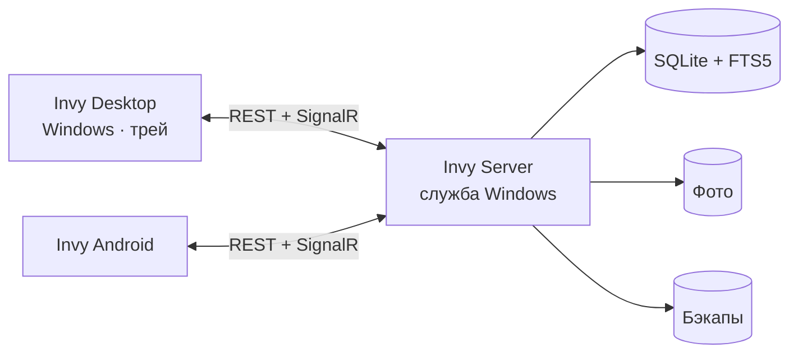

# Invy

**Гибкая домашняя инвентаризация: что где лежит, в какой коробке и сколько.**


> **Статус:** в разработке. Выполнена фаза 0: каркас решения, CI и проверочные прототипы ключевых технологий ([ADR](docs/adr/README.md)). README описывает целевое поведение версии 1.0; план работ, архитектура и модель данных — в [PLAN.md](PLAN.md).

Invy — это «Проводник для вещей». Места, шкафы, коробки и пакеты работают как папки, вещи — как файлы. Кабели, переходники, инструменты, документы — всё заносится за секунды и находится ещё быстрее. Один сервер в домашней сети, приложение для Windows (живёт в трее) и для Android; изменение на одном устройстве сразу видно на всех.

## Возможности

- **Неограниченная вложенность.** Кабель → в пакете → в серой коробке → на чердаке. Перемещение перетаскиванием, вырезать/вставить или «Переместить в…».
- **Свои типы и характеристики.** Создайте тип «Кабель» с полями «Длина», «Версия», «Разъём»; для «Коробки» — свои поля. 10 типов данных: текст, числа, да/нет, дата, списки, ссылка на другую вещь, URL.
- **Фото и иконки.** Несколько фото у любой вещи (синяя коробка, чёрный пакет, zip-пакет), иконки Fluent, эмодзи или свои, цвет.
- **Теги** для любых вещей: `#зарядка`, `#на-продажу`.
- **Мощный поиск.** Мгновенный полнотекстовый поиск по названиям, характеристикам, тегам и местам + фильтры: `тип:кабель длина>=100 в:"серая коробка"`. Сохранённые поиски.
- **Реальное время.** Изменения появляются на всех устройствах за секунду (SignalR).
- **История изменений.** Кто, когда и что изменил — по каждой записи; корзина с восстановлением.
- **Резервное копирование** по расписанию: ротация, проверка целостности, восстановление в пару кликов.
- **Трей Windows.** Глобальная горячая клавиша → найти или добавить вещь, не открывая главное окно.
- **Автозапуск** сервера и Desktop-приложения вместе с Windows.
- **Автообновление в локальной сети.** Приложения сами находят новую версию на сервере и обновляются одним нажатием.
- **Стиль Windows 11:** Mica, Fluent-контролы, тёмная и светлая темы, системный цвет акцента.
- **Удобный ввод:** быстрое добавление, «Сохранить и добавить ещё», дублирование, автодополнение, авто-название по шаблону, режим «Разобрать коробку».

## Как это выглядит

```text
Дом                                   [Место]
└── Чердак                            [Место]
    └── Серая коробка                 [Коробка]   Материал: пластик · Размер: L
        └── Прозрачный пакет          [Пакет]     Вид: zip-lock · Прозрачный: да
            └── Type-A → Type-C, 100 см  [Кабель]  Версия: 3.0 · #зарядка
```

Поиск `usb 3.0` или `кабель в:чердак` найдёт кабель и покажет путь: **Дом › Чердак › Серая коробка › Прозрачный пакет**.

## Как устроено



| Компонент | Что делает |
|-----------|------------|
| **Invy Server** | ASP.NET Core Web API + SignalR. Хранит данные (SQLite) и фото, ищет, пишет историю, делает бэкапы, раздаёт обновления клиентов. Работает как служба Windows. |
| **Invy Desktop** | Приложение для Windows 10/11: «Проводник» по вещам, редакторы, трей, горячие клавиши. |
| **Invy Android** | Просмотр, поиск, добавление с камеры, перемещение. |

Подробно — в [PLAN.md → Архитектура](PLAN.md#4-архитектура).

## Технологии

| Слой | Технологии |
|------|------------|
| Платформа | .NET 10, C# 14 |
| Сервер | ASP.NET Core Web API (Minimal API), SignalR, OpenAPI + Scalar |
| Данные | SQLite (WAL, FTS5), EF Core 10 (схема, миграции, запись), Dapper (поиск, дерево, отчёты) |
| Клиенты | Avalonia UI + FluentAvalonia (Desktop и Android из одного кода), CommunityToolkit.Mvvm, Refit |
| Обновления | Velopack (Desktop), собственный апдейтер APK (Android) |
| Прочее | SkiaSharp (превью фото), Serilog, Cronos, QRCoder |

## Требования

| | Минимум |
|-|---------|
| Сервер | Windows 10/11 x64; желательно всегда включённый ПК или мини-ПК |
| Desktop | Windows 10/11 x64 (Mica — только Windows 11) |
| Android | 8.0 и новее |
| Сеть | Устройства в одной локальной сети; в роутере выключена изоляция Wi-Fi-клиентов |

## Установка

1. **Сервер.** Запустите `Invy.Server-Setup.exe` на ПК, который будет хранить данные. Установщик создаст службу «Invy Server» (автозапуск), правила брандмауэра для частной сети и каталог данных `%ProgramData%\Invy`.
2. **Desktop.** Откройте в браузере `http://<имя-или-IP-сервера>:5470/download` и скачайте `Invy.Desktop-win-Setup.exe`. Установка не требует прав администратора.
3. **Первое подключение.** Приложение само найдёт сервер в сети → «Подключиться». Устройство на том же ПК, что и сервер, подключается без подтверждения и становится администратором.
4. **Android.** На телефоне откройте ту же страницу `/download` (или отсканируйте QR-код в Desktop: *Настройки → Устройства → Подключить телефон*), установите APK и разрешите установку из этого источника. Приложение найдёт сервер и покажет код — подтвердите запрос в уведомлении на ПК.

> Windows SmartScreen может предупредить о неподписанном установщике: «Подробнее» → «Выполнить в любом случае».

## Первые шаги

1. На первом запуске выберите **стартовые типы**: Место, Коробка, Пакет, Кабель, Переходник, Инструмент… (их можно изменить или удалить).
2. Создайте места: **Дом → Чердак**, **Сарай**, **Кладовка**.
3. Откройте место и нажмите **Ctrl+N**: тип «Коробка», название «Серая коробка», фото — перетащите файл или вставьте из буфера (**Ctrl+Shift+V**).
4. Внутри коробки нажмите **«Разобрать коробку»** и добавляйте вещи подряд: фото → тип → название → **Enter**.
5. Найдите что угодно из любого места Windows: **Ctrl+Alt+I** → `usb` → **Enter**.

## Типы и характеристики

**Тип** — шаблон для однотипных вещей. Он задаёт характеристики, иконку и роль:

| Роль | Пример | Может содержать вещи |
|------|--------|----------------------|
| Вещь | Кабель, отвёртка, роутер | нет |
| Контейнер | Коробка, пакет, сумка, ящик | да |
| Место | Дом, чердак, сарай, кладовка, шкаф | да |

**Встроенные поля** есть у любой вещи, их не нужно создавать: название, описание, количество и единица, где лежит, теги, фото, иконка.

**Пример — тип «Кабель»** (*Типы → Новый тип*):

| Характеристика | Тип данных | Настройки |
|----------------|------------|-----------|
| Длина | Целое число | единица «см» |
| Версия | Список | 2.0 / 3.0 / 3.1 / 3.2 / USB4 |
| Разъём 1 | Список | общий справочник «Разъёмы»: Type-A / Type-C / Micro-B / Lightning … |
| Разъём 2 | Список | тот же справочник «Разъёмы» |
| Цвет | Текст | автодополнение, запоминать последнее значение |

Шаблон названия `{Разъём 1} → {Разъём 2}, {Длина} см` сам назовёт кабель «Type-A → Type-C, 100 см».

Полезно знать:

- новый вариант списка можно добавить прямо при заполнении: «+ Добавить "Type-C"»;
- один справочник можно использовать в нескольких полях и типах;
- поля группируются в секции («Габариты», «Покупка») и сортируются перетаскиванием;
- конструктор типа показывает живой предпросмотр формы;
- удалённое поле скрывается, а значения и история сохраняются.

## Поиск — шпаргалка

Набирайте как в обычном поиске — работают префиксы, регистр и «ё» не важны. Фильтры можно задавать текстом или чипами на панели фильтров.

| Запрос | Что найдёт |
|--------|------------|
| `кабель usb` | все слова; найдутся и «кабели», и «USB-C» |
| `"серая коробка"` | точную фразу |
| `type-c \| lightning` | любое из слов |
| `-hdmi` | без слова |
| `#зарядка` / `-#старое` | с тегом / без тега |
| `тип:кабель` | вещи типа (и подтипов) |
| `в:"серая коробка"` | внутри контейнера на любой глубине |
| `длина>=100`, `длина:50..150` | по числовой характеристике |
| `версия:3.0,3.1` | по значению списка |
| `"разъём 1":type-c` | по полю с пробелом в названии |
| `есть:фото` / `нет:фото` | с фото / без фото |
| `нет:места` | неразобранные вещи |
| `изменено:<7д`, `создано:>2026-01-01` | по датам |
| `кол-во<3` | заканчивающиеся вещи |
| `№123` | по инвентарному номеру |

Ключи понимаются и по-английски: `type:`, `in:`, `has:photo`, `qty<3`. Если запрос набран не в той раскладке (`rf,tkm`), Invy предложит результаты для «кабель». Любой поиск можно сохранить — он появится в боковой панели.

## Горячие клавиши

| Сочетание | Действие |
|-----------|----------|
| `Ctrl+Alt+I` | Быстрый поиск из любого места Windows |
| `Ctrl+Alt+N` | Быстро добавить вещь из любого места Windows |
| `Ctrl+F` | Поиск в окне |
| `Ctrl+N` / `Ctrl+Shift+N` | Новая вещь / новый контейнер здесь |
| `Ctrl+D` | Дублировать |
| `F2` / `Ctrl+E` | Переименовать / редактировать |
| `Ctrl+S` / `Ctrl+Enter` | Сохранить / сохранить и добавить ещё |
| `Ctrl+X` → `Ctrl+V` | Переместить |
| `Ctrl+Shift+V` | Вставить фото из буфера |
| `Del` | В корзину |
| `Ctrl+1` / `2` / `3` | Список / таблица / плитки |

Глобальные сочетания меняются в *Настройки → Трей и горячие клавиши*.

## Резервное копирование

*Настройки → Резервное копирование* (доступно администратору):

- **Расписание** — по умолчанию ежедневно в 03:00; можно каждые N часов, еженедельно или своё cron-выражение. Если изменений не было, копия не создаётся.
- **Куда** — по умолчанию `%ProgramData%\Invy\backups`; добавьте внешний диск, сетевую папку (`\\NAS\backup`) или папку облачного диска.
- **Хранение** — 7 ежедневных, 4 еженедельных, 12 ежемесячных копий.
- **Проверка** — каждая копия проверяется `PRAGMA integrity_check`; при ошибке придёт уведомление.
- **Фото** копируются инкрементально — только новые файлы.

Копии создаются и автоматически: перед обновлением схемы БД и перед восстановлением.

**Восстановление:** *Резервное копирование → выбрать копию → Восстановить*. Сервер временно переходит в режим обслуживания, клиенты увидят баннер и перезагрузят данные. Если сервер не запускается:

```powershell
& "C:\Program Files\Invy Server\Invy.Api.exe" restore "D:\Backups\invy-2026-11-04_0300.zip"
```

## Обновления

- **Desktop** проверяет обновления на сервере при запуске, каждые 6 часов и сразу после публикации новой версии. Обновление скачивается в фоне, затем — кнопка **«Перезапустить»** (или установка при выходе; можно включить полностью автоматический режим).
- **Android** показывает **«Доступна версия X — Обновить»**, скачивает APK и открывает системную установку. Android попросит подтверждение; на Android 12+ последующие обновления могут ставиться без него.
- **Сервер** обновляется новым установщиком; перед миграцией БД автоматически создаётся бэкап.

## Автозапуск

| Компонент | Как запускается |
|-----------|-----------------|
| Сервер | Служба Windows «Invy Server», автоматически (отложенный запуск), перезапуск при сбое. Работает без входа пользователя |
| Desktop | Ключ `HKCU\…\Run` с флагом `--background` — сразу в трей, без окна. Переключатель: *Настройки → Автозапуск* |

## Безопасность

- Сервер доступен только в локальной сети; правила брандмауэра — для профиля «Частная сеть».
- Каждое устройство подключается по запросу, который подтверждает администратор; доступ можно отозвать в *Настройки → Устройства*.
- Роли: **Администратор**, **Редактор**, **Просмотр**.
- Токены устройств хранятся на сервере только в виде хэша, на клиентах — в защищённом хранилище (DPAPI / Android Keystore).
- Не открывайте порт сервера в интернет. Для доступа извне используйте VPN (WireGuard, Tailscale).

## Где хранятся данные

| Что | Путь |
|-----|------|
| БД, фото, бэкапы, релизы, логи сервера | `%ProgramData%\Invy\` |
| Программа сервера | `C:\Program Files\Invy Server\` |
| Программа Desktop | `%LocalAppData%\Invy.Desktop\` |
| Настройки Desktop | `%AppData%\Invy\` |
| Кэш фото и логи Desktop | `%LocalAppData%\Invy\` |

## Настройка сервера

`C:\Program Files\Invy Server\appsettings.json` или переменные окружения (`Invy__Http__Port=5470`):

| Параметр | По умолчанию | Описание |
|----------|--------------|----------|
| `Invy:DataPath` | `%ProgramData%\Invy` | Каталог данных |
| `Invy:Http:Port` | `5470` | Порт API, SignalR и страницы загрузки |
| `Invy:Discovery:Enabled` | `true` | Отвечать на поиск сервера в сети |
| `Invy:Discovery:Port` | `5471` | UDP-порт обнаружения |
| `Invy:Auth:Mode` | `Pairing` | `Pairing` — сопряжение устройств; `TrustedLan` — без авторизации (только для доверенной сети) |
| `Invy:Media:MaxUploadMb` | `25` | Максимальный размер файла |
| `Invy:Trash:RetentionDays` | `30` | Срок хранения в корзине |

Расписание и папки бэкапов настраиваются в приложении и хранятся в БД.

## Разработка

### Окружение

- .NET 10 SDK (версия зафиксирована в `global.json`)
- Workload Android: `dotnet workload install android` (+ JDK 17 и Android SDK — ставятся вместе с IDE)
- IDE: Visual Studio 2026, JetBrains Rider или VS Code + C# Dev Kit; для XAML — расширение Avalonia
- Velopack CLI (`vpk`) — локальный инструмент репозитория, ставится командой `dotnet tool restore`
- Необязательно: `AVALONIA_TELEMETRY_OPTOUT=1` отключает сбор статистики сборки Avalonia

### Запуск

```bash
git clone https://github.com/IichiKohuro/Invy.git
```

```bash
cd Invy && dotnet restore
```

Без Android SDK собирайте фильтр решения — всё, кроме Android-проекта:

```bash
dotnet build Invy.NoAndroid.slnf
```

Сервер (API — `http://localhost:5470`, документация API — `http://localhost:5470/scalar`, данные dev-сервера — в `.data/server`):

```bash
dotnet run --project src/Invy.Api
```

Desktop (сервер по умолчанию — `http://localhost:5470`; другой адрес — переменная `INVY_SERVER` или поле в настройках):

```bash
dotnet run --project src/Invy.Desktop
```

Android (эмулятор или телефон с отладкой по USB):

```bash
dotnet build src/Invy.Android -t:Run -f net10.0-android
```

Тесты (UI-тесты сохраняют скриншоты в `tests/Invy.Client.Tests/bin/…/screenshots`):

```bash
dotnet test Invy.NoAndroid.slnf
```

Новая миграция БД:

```bash
dotnet ef migrations add <Name> --project src/Invy.Infrastructure --startup-project src/Invy.Api
```

### Выпуск версии

Сейчас Desktop и Android упаковываются отдельными скриптами — результат сразу попадает в каталог релизов сервера (по умолчанию `%ProgramData%\Invy\releases\…`), и клиенты находят обновление сами:

```powershell
./tools/pack-desktop.ps1 -Version 1.4.0
```

```powershell
./tools/pack-android.ps1 -Version 1.4.0 -KeyStore D:\keys\invy.keystore
```

В фазе 8 появится единый `tools/release.ps1`: тесты + оба пакета одной командой. Пароль keystore передаётся через переменную окружения `INVY_KEYSTORE_PASS`. Keystore храните в надёжном месте: без него обновить уже установленные APK невозможно.

### Структура репозитория

```text
src/
  Invy.Contracts        DTO и события SignalR — общие для сервера и клиентов
  Invy.Domain           сущности и доменные правила
  Invy.Application      сценарии использования
  Invy.Infrastructure   EF Core, Dapper, SQLite/FTS5, медиа, бэкапы, аудит
  Invy.Api              Web API, SignalR, служба Windows, обнаружение, обновления
  Invy.Client.Core      API-клиент, SignalR-клиент, ViewModels
  Invy.Client.UI        общие Avalonia-View и стили
  Invy.Desktop          Windows: трей, горячие клавиши, автозапуск, Velopack
  Invy.Android          Android: камера, установка обновлений
tests/                  unit-, интеграционные, API- и UI-тесты
tools/                  скрипты выпуска и установки
docs/                   ADR, макеты, чек-лист релиза
```

### Соглашения

- Ветки `feature/*` → Pull Request → `main`; сообщения коммитов — [Conventional Commits](https://www.conventionalcommits.org/ru/).
- Версии — SemVer; nullable включён, предупреждения — ошибки, `dotnet format` перед коммитом.
- Значимые архитектурные решения фиксируются в `docs/adr/`.

## Решение проблем

| Проблема | Что проверить |
|----------|---------------|
| Клиент не находит сервер | Служба запущена (`Get-Service InvyServer`); профиль сети на сервере — «Частная»; в роутере выключена изоляция Wi-Fi-клиентов. Можно ввести адрес вручную: `http://192.168.1.10:5470` |
| Телефон не подключается | Телефон в той же сети (не гостевой), VPN на телефоне выключен; откройте `http://<сервер>:5470/health` в браузере телефона |
| Не срабатывает горячая клавиша | Сочетание занято другой программой — смените его в настройках |
| Не приходит обновление | В `%ProgramData%\Invy\releases` есть новая версия; клиент подключён к серверу (индикатор «Онлайн») |
| Сервер не запускается | Логи в `%ProgramData%\Invy\logs` и журнале событий Windows; при повреждении БД — восстановление из бэкапа (см. выше) |

## Дорожная карта

Коротко: фундамент → ядро сервера → Desktop → поиск → трей → Android → история и корзина → бэкапы → обновления → безопасность → 1.0. Подробно, с задачами и критериями готовности, — в [PLAN.md](PLAN.md#12-дорожная-карта).

## Лицензия

Пока не выбрана.
