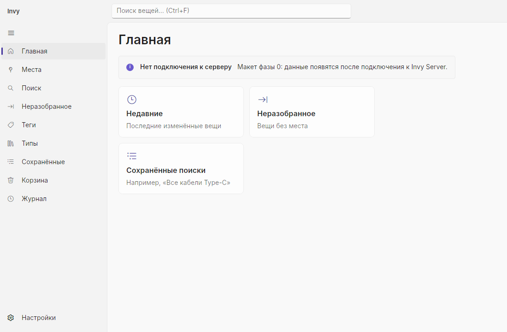
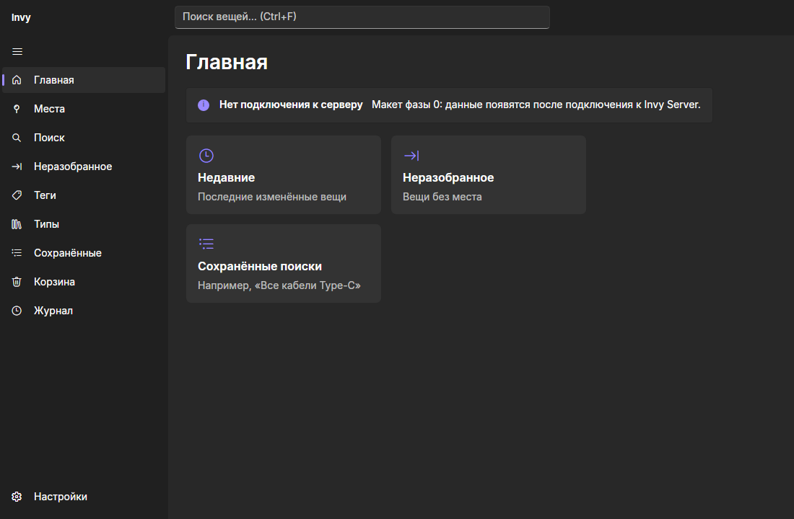
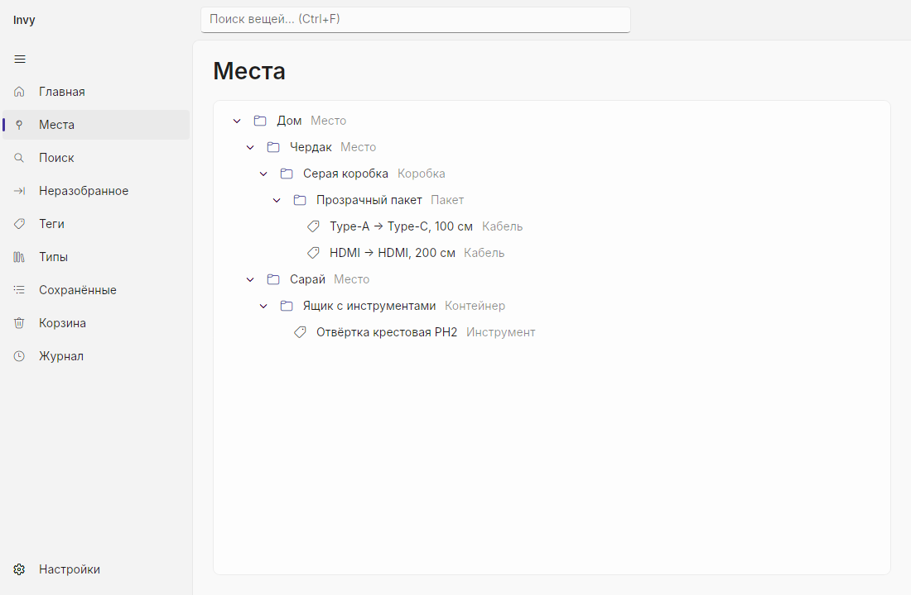
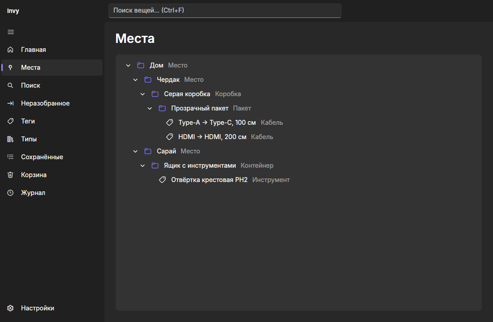

# 0002. UI: Avalonia 12 + FluentAvalonia 3

**Статус:** Принято с оговорками (спайк фазы 0, 2026-11-04) — Mica и Android проверяются вручную, см. [чек-лист](../spikes/phase-0/checklist.md)

## Контекст

Нужен один UI-код для Windows и Android в стиле Windows 11 (Mica, Fluent-контролы, тёмная/светлая тема). На момент старта стабильна **Avalonia 12.1.5** (план допускал 11.3 или 12) и **FluentAvaloniaUI 3.1.0**, собранная под Avalonia 12.

## Что показал спайк

| Проверка | Результат |
|----------|-----------|
| Сборка Avalonia 12 + FluentAvalonia 3 на .NET 10 | Без предупреждений (compiled bindings по умолчанию) |
| `FANavigationView` с `MenuItemsSource` / `FooterMenuItemsSource` и двусторонним `SelectedItem` | Работает; ViewModels не зависят от FluentAvalonia (иконки — имена символов + конвертер) |
| Переключение темы на лету (`Application.RequestedThemeVariant`) | Работает; тест проверяет яркость фона в обеих темах |
| `FAInfoBar`, `FASettingsExpander`, `FASymbolIcon`, `TreeView` | Выглядят как в Windows 11, см. скриншоты ниже |
| Кириллица | Корректно (в тестах — шрифт Inter; на Windows — Segoe UI Variable) |
| Headless-рендер со скриншотами | `Avalonia.Headless` + Skia: окно снимается в PNG без дисплея — основа UI-тестов |
| Mica (`TransparencyLevelHint = Mica`) | Включается только на Windows 11 (сборка ≥ 22000); **на реальной Windows не проверено** |
| Заголовок окна со строкой поиска (`FAAppWindow`, `ExtendsContentIntoTitleBar`) | Собирается и рендерится; перетаскивание окна за заголовок **проверить на Windows** |

| Светлая | Тёмная |
|---------|--------|
|  |  |
|  |  |

## Решение

1. **Avalonia 12.1 + FluentAvalonia 3.1.** Контролы FA 3 имеют префикс `FA` (`FANavigationView`, `FAInfoBar`, `FAAppWindow`…).
2. **MVVM:** CommunityToolkit.Mvvm с partial-свойствами; страницы сопоставляются с View через `Application.DataTemplates`.
3. **Иконки** в ViewModels — строковые имена символов Fluent (`"MapPin"`), в UI — `FluentSymbolConverter`.
4. **Главное окно** — `FAAppWindow` со своим заголовком (название + поиск) и Mica на Windows 11.
5. **Desktop — TFM `net10.0`**, а не `net10.0-windows`: Windows-код защищён `OperatingSystem.IsWindows…()`, приложение собирается и запускается и на Linux (CI, отладка UI). Перейдём на `-windows`, если понадобятся WinRT API.
6. **UI-тесты** — `Avalonia.Headless.XUnit` с настоящей отрисовкой Skia; xUnit v3 закреплён на 3.2.x (под него собран Avalonia.Headless.XUnit 12.1).

## Последствия

- Сборка Avalonia 12 отправляет телеметрию (`Avalonia.BuildServices`). Для бесплатной версии она отключается переменной окружения `AVALONIA_TELEMETRY_OPTOUT=1` — задана в CI.
- Avalonia.Headless рендерит без Mica и системного заголовка — это проверяется только на Windows вручную.
- При проблемах FluentAvalonia на Android запасной вариант — встроенная тема Avalonia Fluent для мобильных View (ViewModels не меняются).
