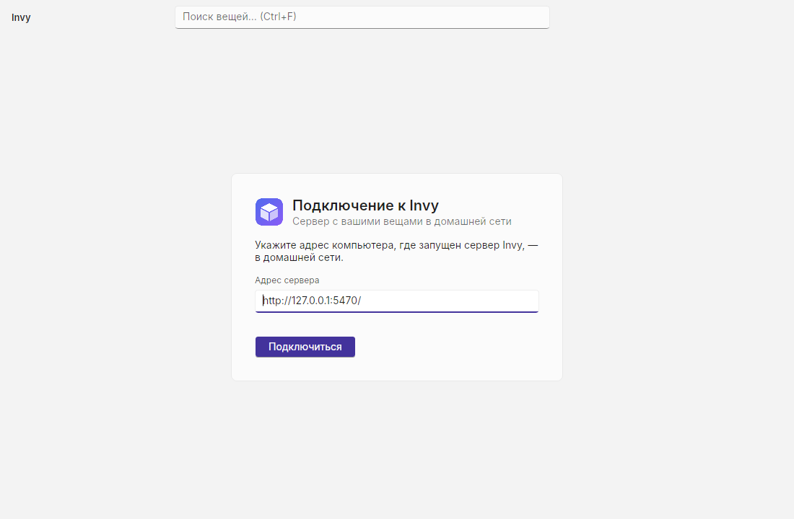
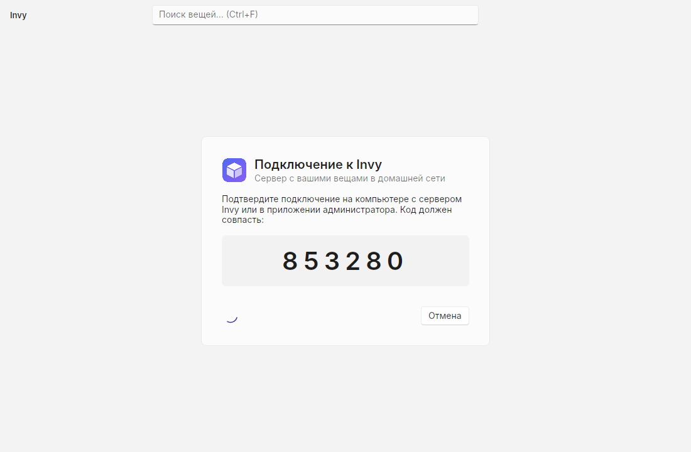
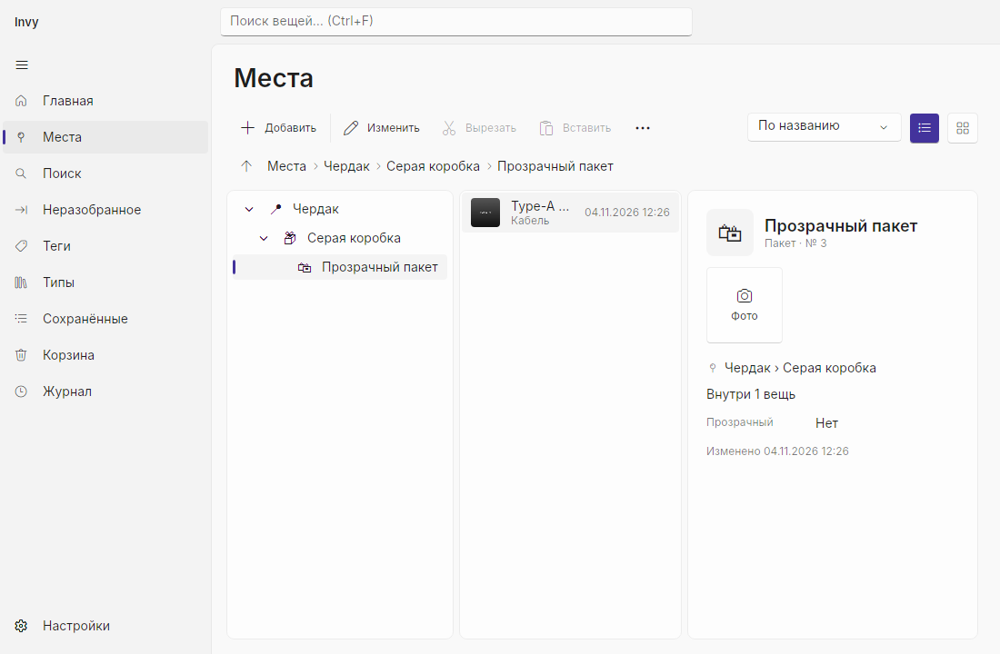
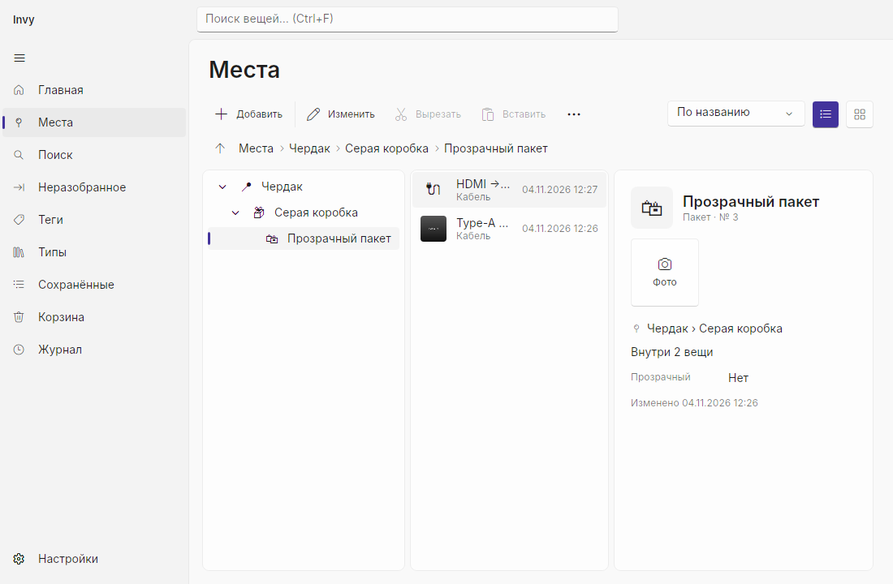
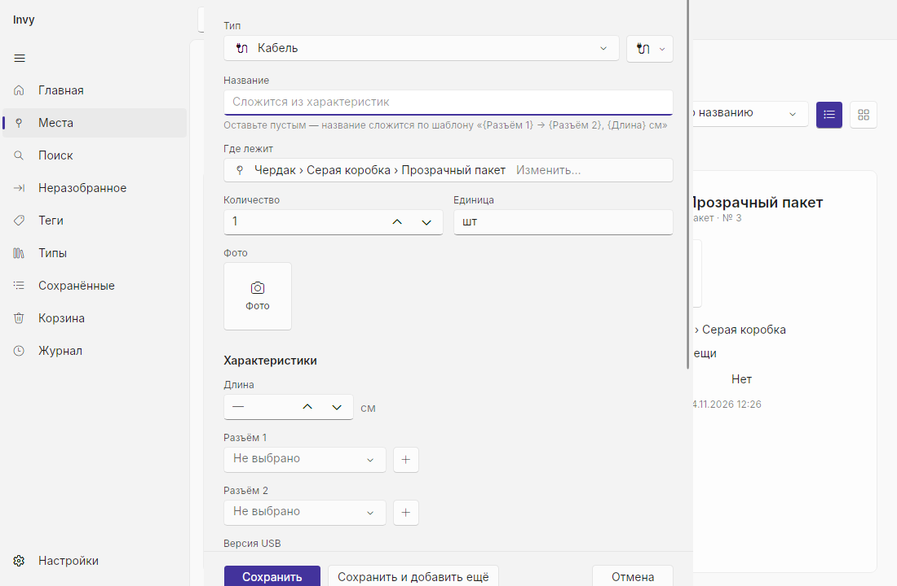
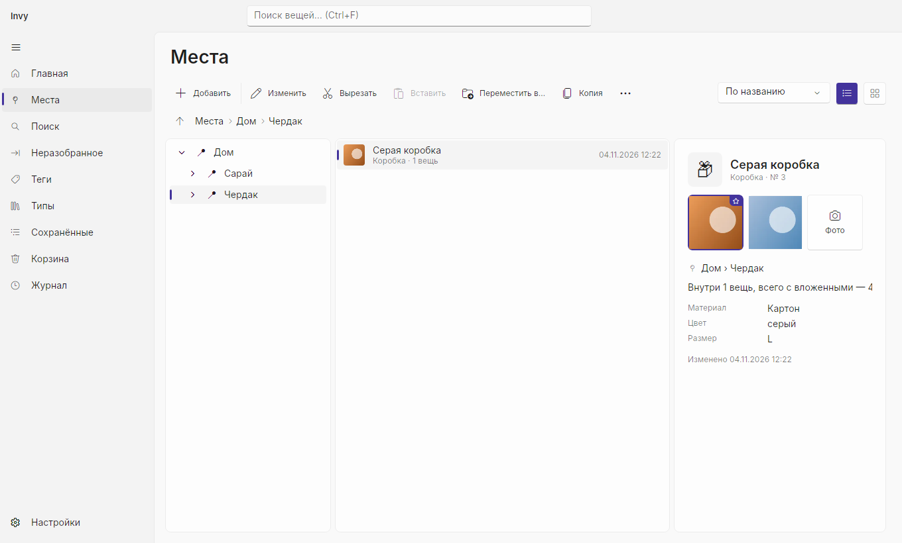
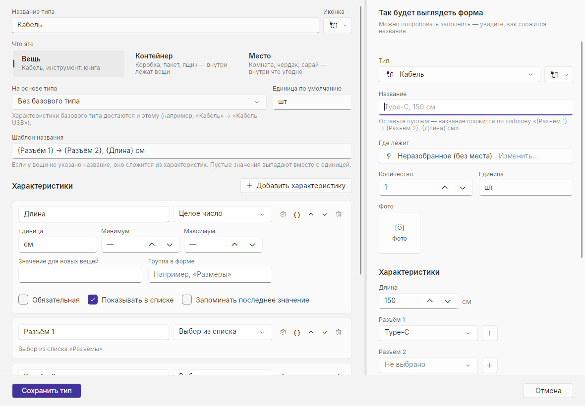
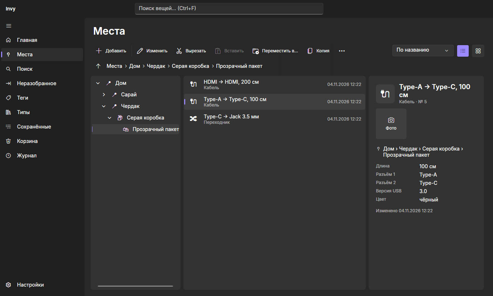

# Фаза 2: сквозная проверка Desktop MVP

**Дата:** 2026-11-04 · **Сборка:** Release, Linux (Xvfb) · **Сервер:** Kestrel + SQLite, SignalR по WebSocket

Критерий готовности фазы: *цепочка «Чердак → Серая коробка → Пакет → Кабель» с фото заводится за пару минут; изменения видны на втором ПК ≤ 1 с.*

## Как проверялось

1. Настоящий сервер: `dotnet Invy.Api.dll --urls http://127.0.0.1:5470` (режим «Доверенная сеть», чистый каталог данных).
2. Настоящее приложение `Invy.Desktop` под Xvfb с чистым профилем пользователя; действия — `xdotool` (щелчки и клавиши), снимки — `import`.
3. Второе устройство — скрипт [`tools/e2e-phase2.cs`](../../../tools/e2e-phase2.cs) на `Invy.Client.Core`: заполняет те же ViewModel, что и формы Desktop (тип, характеристики, фото, место), и меряет задержку живых обновлений.

```bash
dotnet run tools/e2e-phase2.cs -- http://127.0.0.1:5470/ chain <каталог с box.png и cable.png>
```

```bash
dotnet run tools/e2e-phase2.cs -- http://127.0.0.1:5470/ latency
```

## Результаты

| Проверка | Результат |
|----------|-----------|
| Первый запуск Desktop: экран подключения с адресом по умолчанию → Enter | ✅ подключено, справочники и SignalR подняты, настройки сохранены в `~/.config/Invy` (Windows: `%AppData%\Invy`) |
| Цепочка Чердак → Серая коробка (фото) → Прозрачный пакет → Кабель (фото), авто-название «Type-A → Type-C, 100 см» | ✅ 4 вещи и 2 фото — 1,2 с работы сервера и клиента; остальное — ввод человеком (тип и место подставляются сами) |
| Desktop: «Места» → двойной щелчок до пакета; дерево раскрывается, крошки, превью обложки | ✅ [снимок](desktop-explorer.png) |
| Второе устройство добавляет кабель, Desktop открыт на пакете | ✅ новый кабель и «Внутри 2 вещи» на снимке через 0,5 с после ответа сервера — [снимок](desktop-live-update.png) |
| Задержка до второго устройства (10 изменений, «Проводник» второго клиента открыт на пакете) | ✅ медиана **19 мс**, максимум **60 мс** (цель ≤ 1 с) |
| Ctrl+N в пакете → окно «Новая вещь» с типом «Кабель» и местом «Чердак › Серая коробка › Прозрачный пакет»; ввод названия, сохранение с клавиатуры | ✅ [снимок](desktop-editor.png); список и дерево обновились |

## Что нашла проверка и что исправлено

- **Настройки Desktop сохранялись рядом с программой**, если на чистой системе ещё нет папки профиля: `Environment.GetFolderPath` возвращает пустую строку. Теперь папка создаётся (`SpecialFolderOption.Create`).
- **Горячие клавиши «Мест» не срабатывали** после щелчка по пустому месту списка — фокус уходил из страницы. Страница удерживает фокус.
- **Тип по умолчанию:** на новом устройстве (без истории) внутри пакета предлагался «Шкаф». Теперь без истории: в контейнер — вещь, в место — контейнер, в корень мест — место.
- «Главная» ещё показывала плашку фазы 0 «Нет подключения» — убрана, плитки ведут в разделы.

Раньше, на тестах ViewModel против сервера в памяти, найдены и исправлены: шаблон авто-названия давал «см» при пустых полях (сервер и клиент), обновление по SignalR во время перехода отменяло переход в другое место.

## Снимки

| | |
|---|---|
|  Первый запуск |  Сопряжение: код для сверки |
|  «Проводник» в пакете |  Кабель со второго устройства |
|  Новая вещь (Ctrl+N) |  Обложки и лента фото |
|  Конструктор типа с предпросмотром |  Тёмная тема |

Снимки без подписи «Desktop» — из headless-тестов `tests/Invy.Client.Tests` (те же View, сервер в памяти). Эмодзи-иконки в Linux без цветного шрифта выглядят монохромными; в Windows — цветные (Segoe UI Emoji).

## Не проверено здесь

Mica, трей и глобальные клавиши `Ctrl+Alt+I` / `Ctrl+Alt+N` на Windows, DPAPI для токена — входят в ручной [чек-лист фазы 0](../../spikes/phase-0/checklist.md) (нужен Windows).
